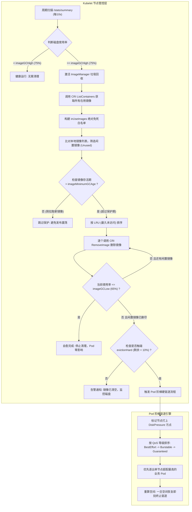

# Node 节点镜像 GC 与驱逐策略深度架构与生产实战指南

> [!NOTE]
> 本文档基于生产真实环境（K8s v1.24+ / Containerd 运行时）中发生的“自定义清理脚本误杀镜像导致 403 阻断拉取”典型事故，经过十轮深度推导与架构推演，全面梳理 Kubelet 镜像垃圾回收（Image GC）、节点存储分层（nodefs vs imagefs）、Pod 阶梯驱逐机制、LRU 淘汰算法、CRI 底层锁以及企业级生产调优决策树。

---

## 1. 业务背景与技术定位 (Context & Core Value)

- **解决的核心痛点**：
  - **磁盘暴满导致节点脱机**：容器镜像拉取、业务日志落盘及临时数据写入会导致宿主机根分区（`/`）磁盘空间枯竭，引发 Linux 内核只读挂载或节点 `DiskPressure` 停机。
  - **粗暴清理引发次生灾害**：运维人员私自部署 Host 级 Crontab 脚本执行 `crictl rmi`，因哈希类型失配导致集群非活跃镜像被无差别抹除，在遭遇外部镜像加速站失效（如 403 Forbidden）时，引发大规模 Pod 漂移后无法冷拉取的瘫痪事故。
  - **GC 与驱逐阈值竞态冲突**：默认配置下镜像高水位（85%）与硬驱逐线（剩余 15%）在同一点重合，极易导致 Kubelet 未等镜像清理完成便误杀业务 Pod。
- **演进历程与架构位置**：
  - K8s v1.24+ 彻底废弃 Dockershim，Kubelet 通过标准 CRI gRPC 接口直接管控 Containerd / CRI-O 的镜像与容器生命周期。
  - 镜像 GC 是节点自愈与弹性治理的第一道防线，介于业务资源限制与节点硬驱逐之间。

---

## 2. 核心架构与底层原理解析 (Architecture & Deep Dive)



### 2.1 存储拓扑分层：nodefs vs imagefs

Kubelet 在评估磁盘压力时，严格区分两类独立文件系统（Filesystem）：

| 文件系统 | 典型挂载目录 | 承载数据内容 | 对应驱逐阈值指标 |
| :--- | :--- | :--- | :--- |
| **`nodefs`** | `/` (根目录) 或 `/var/lib/kubelet` | Kubelet 内部状态、Pod 的 `emptyDir` 卷、容器退出日志、系统日志（`/var/log`） | `nodefs.available`<br/>`nodefs.inodesFree` |
| **`imagefs`** | `/var/lib/containerd` (或独立挂载盘) | 镜像各只读层（Content Store）、容器可写层（Overlayfs Snapshotter） | `imagefs.available`<br/>`imagefs.inodesFree` |

> [!IMPORTANT]
> **单分区共享陷阱**：
> 当节点未给 Containerd 划分独立数据盘时，`imagefs` 与 `nodefs` 共享同一个宿主机根分区（即 `imagefs == nodefs`）。此时，**业务容器日志暴涨或写入 emptyDir 会直接吞噬镜像存储空间**，迅速引爆全局驱逐。

### 2.2 核心组件与通信机制（Kubelet 与 Containerd CRI）

1. **`imageManager` (Kubelet 内部控制器)**：
   - 定期通过 gRPC 向 Containerd 的 `/runtime.v1.ImageService/` 发起 `ListImages` 和 `ImageFsInfo` 调用；
   - 维护本地内存中的 `imageRecord` 字典，记录镜像大小、初次检测时间（`firstDetected`）以及最后使用时间（`lastUsed`）。
2. **免死白名单构建算法**：
   - 扫描当前节点所有状态的容器（包含 `Running`、`Created`、`Exited`、`Paused`）；
   - 将所有容器所绑定的镜像 Digest 与 ID 加入 `inUse` 哈希集合；
   - 处于 `inUse` 集合内的镜像拥有绝对免死权，任何 GC 逻辑均无权触碰。
3. **Containerd 底层 Lease 锁保护**：
   - 即使外部下发删除指令，Containerd 内部为每个容器保持着 Snapshot 租约（Lease）；
   - 若检测到正在运行的容器占有引用，底层引擎直接拒绝删除并返回 `image is currently in use`。

### 2.3 十轮推导核心认知矩阵

| 轮次 | 核心探索问题 | 架构结论与底层事实 |
| :---: | :--- | :--- |
| **第 1 轮** | Kubelet 会不会误删运行中服务的镜像？ | **绝对不会**。Kubelet 具备两层屏障：内存 `inUse` 白名单过滤与 CRI 容器运行时物理 Lease 写锁。 |
| **第 2 轮** | 为什么 Kubelet 默认配置在生产中极易造成误伤？ | 默认 `GC High=85%` 与 `evictionHard=15%` 处于同一阈值线，GC 异步删镜像的耗时赶不上驱逐判断，极易触发 Pod 误杀。 |
| **第 3 轮** | 自定义 Crontab 脚本删镜像为什么会导致全集群清空？ | `crictl ps` 提取的是 **Manifest/Digest 哈希**，而 `crictl images` 第 3 列是 **Config ID 哈希**，文本匹配永久为 False，导致所有闲置镜像被无差别屠杀。 |
| **第 4 轮** | 为什么老服务跑了 3 年突然陷入 ImagePullBackOff？ | 镜像原本仅存在于单节点本地，Pod 发生**跨节点漂移**至新节点触发冷拉取，遇国内云厂商封禁公共镜像加速（403），导致全集群无法复活。 |
| **第 5 轮** | Pod 驱逐是否会导致所有服务同时崩溃？ | **不会**。驱逐遵循 QoS 阶梯淘汰制：`BestEffort` $\rightarrow$ `Burstable` $\rightarrow$ `Guaranteed`，单步逐出并实时验算空间，空间恢复立即收手。 |
| **第 6 轮** | 为什么刚拉下来的新镜像会在发版时被意外清理？ | 缺乏 `imageMinimumGCAge` 保护窗口。若未配置该参数，高频发布拉取大镜像瞬间触发 GC，新镜像未等启动便被按未引用状态清理。 |
| **第 7 轮** | 如何区分是磁盘满还是 Inode 满？ | Inode 枯竭（海量微小日志）同样会触发 `DiskPressure`。需联动监控 `nodefs.inodesFree`（默认 < 5% 立即驱逐）。 |
| **第 8 轮** | Docker 与 Containerd 在镜像存储上的本质区别？ | Docker 共用 `docker-root`，而 Containerd 采用分离式设计（Content Store 存元数据 blob，Snapshotter 存解压文件系统），对租约（Lease）管理更严格。 |
| **第 9 轮** | 生产如何防止冷拉取失败？ | 建立企业内网私有 Harbor，严禁在生产 Pod YAML 中硬编码公网不可信镜像站（如失效的个人加速器），辅以 P2P 预热技术。 |
| **第 10 轮** | 节点自愈的最优雅配置分层？ | 实行“**三级蓄水池架构**”：75% 触发静默 GC 自愈 $\rightarrow$ 80% 停止自愈 $\rightarrow$ 90% 触发告警与最后防线 Pod 阶梯驱逐。 |

### 2.4 深度剖析：Pod 日志膨胀引发的“多米诺骨牌”连锁反应

在单分区架构（`imagefs == nodefs`）中，**日志膨胀往往是导致镜像被误删、Pod 遭驱逐的真正源头罪魁**：

```text
业务死循环狂写日志 
  └──> 宿主机根分区磁盘突破 85%
        └──> Kubelet 误判为镜像占用，启动 Image GC 疯狂清理闲置镜像（镜像沦为替罪羊！）
              └──> 闲置镜像清空后空间仍不下降，磁盘突破 90%
                    └──> Kubelet 触发 Eviction 驱逐引擎，节点打上 DiskPressure 并开始斩杀业务 Pod
```

#### 两类日志的存储差异与风险对比：
1. **控制台标准输出日志 (`stdout / stderr`)**：
   - **存储路径**：宿主机 `/var/log/pods/`。
   - **Kubelet 原生防护**：内置轮转机制 `containerLogMaxSize: 10Mi`、`containerLogMaxFiles: 5`。
   - **风险等级**：中等。正常单个容器最多占用约 $5 \times 10\text{MB} = 50\text{MB}$，通常不易单独打爆大磁盘。
2. **容器内部自写文件日志 (`/app/logs/*.log` 或 `emptyDir`)**：
   - **存储路径**：容器 OverlayFS 可写层（`/var/lib/containerd/.../overlayfs/`）。
   - **Kubelet 原生防护**：**完全无轮转机制（黑洞盲区）**！
   - **风险等级**：**极高（火警级）**。若无限制，业务异常可在几小时内产生数十 GB 日志，直接引爆节点崩溃。

---

## 3. 生产级关键配置与参数调优 (Production Tuning)

### 3.1 Kubelet 参数黄金对照表

针对单节点 100GB~500GB SSD 存储规模的生产环境，推荐将 Kubelet 默认参数调整为三级蓄水池结构：

| 参数名称 | 生产推荐值 | 社区默认值 | 作用与深度调优依据 |
| :--- | :---: | :---: | :--- |
| `imageGCHighThresholdPercent` | **`75`** | `85` | **提前触发自愈**：磁盘达到 75% 立即在后台静默删除闲置镜像，防患于未然。 |
| `imageGCLowThresholdPercent` | **`65`** | `80` | **拉大缓冲落差**：清理至 65% 收手，形成 10% 的缓冲带，杜绝磁盘在临界点频繁启停震荡。 |
| `imageMinimumGCAge` | **`5m`** | `2m` | **发版防抖保护**：刚拉取到节点未满 5 分钟的镜像绝对受保护，避免大版本并发滚动发版时新镜像被抢先误删。 |
| `evictionHard.imagefs.available` | **`10%`** | `15%` | **拉开自愈与驱逐鸿沟**：与 GC High（75%）之间形成整整 **15% 的安全降温空间**，绝不给 Kubelet 误杀 Pod 的机会。 |
| `evictionHard.nodefs.available` | **`10%`** | `10%` | 根分区保底防线，保留 10% 避免 Linux 操作系统因空间耗尽卡死。 |
| `evictionHard.nodefs.inodesFree` | **`5%`** | `5%` | 防止微小日志与未释放的 socket 耗尽 Inode 节点。 |

### 3.2 Kubelet 单文件标准落地配置 (`/var/lib/kubelet/config.yaml`)

```yaml
# -------------------------------------------------------------
# 【生产推荐：平滑自愈与防误杀安全调优 (K8s 1.24+ 现代化标准)】
# -------------------------------------------------------------
imageGCHighThresholdPercent: 75
imageGCLowThresholdPercent: 65
imageMinimumGCAge: 5m

evictionHard:
  imagefs.available: "10%"
  nodefs.available: "10%"
  nodefs.inodesFree: "5%"
  memory.available: "100Mi"

# 增加软驱逐缓冲期：先告警通知 SRE，留出人工清理时间，防止直接硬杀 Pod
evictionSoft:
  imagefs.available: "15%"
  nodefs.available: "15%"
evictionSoftGracePeriod:
  imagefs.available: "5m"
  nodefs.available: "5m"

# -------------------------------------------------------------
# 【注释备用：Kubernetes 官方原生默认策略 (慎用：极易高频震荡)】
# -------------------------------------------------------------
# imageGCHighThresholdPercent: 85
# imageGCLowThresholdPercent: 80
# imageMinimumGCAge: 2m
# evictionHard:
#   imagefs.available: "15%"
#   nodefs.available: "10%"
#   nodefs.inodesFree: "5%"
#   memory.available: "100Mi"
```

---

## 4. 生产高频踩坑与排障决策树 (Troubleshooting Matrix)

### 4.1 故障场景一：Pod 长期处于 ImagePullBackOff（403 阻断）

```mermaid
flowchart TD
    A["Pod 报 ImagePullBackOff / ErrImagePull"] --> B["kubectl describe pod 查看 Events"]
    B --> C{"报错包含 403 Forbidden<br/>或 mirror.aliyuncs ?"}
    C -->|"是"| D["判定为公网加速器关停或 VPC 未绑定"]
    C -->|"否"| E["检查网络、DNS、凭证或镜像 Tag 拼写"]
    D --> F["从其他健康节点导出一份镜像"]
    F --> G["ctr -n k8s.io images export/import 导入故障节点"]
    G --> H["Pod 瞬间自愈恢复 Running"]
    H --> I["长效治理: 检查 containerd 配置并迁移至私有 Harbor"]
```



- **现象**：
  ```text
  pulling from host 0bo4n5zl.mirror.aliyuncs.com failed with status code [manifests v2.6.0]: 403 Forbidden
  ```
- **根因**：国内公共加速通道受限，且历史运行的 Pod 重启漂移至未缓存该镜像的新节点，触发冷拉取阻断。
- **应急与根治命令**：
  ```bash
  # 步骤 1：利用国内代理拉取（在故障节点执行）
  crictl pull docker.m.daocloud.io/rancher/mirrored-kube-state-metrics-kube-state-metrics:v2.6.0

  # 步骤 2：对标原生镜像名打 Tag
  ctr -n k8s.io image tag \
    docker.m.daocloud.io/rancher/mirrored-kube-state-metrics-kube-state-metrics:v2.6.0 \
    docker.io/rancher/mirrored-kube-state-metrics-kube-state-metrics:v2.6.0
  ```

---

### 4.2 故障场景二：节点打上 DiskPressure，业务 Pod 遭遇 Evicted 驱逐

- **现象**：
  `kubectl get nodes` 显示某节点带有 `DiskPressure`；大量业务 Pod 状态变为 `Evicted`。
- **根因**：
  磁盘空间突破 `evictionHard`，且可能由于日志写满根盘，导致 Image GC 即使删光闲置镜像也无法使剩余空间超过 10%。
- **排障三板斧**：
  ```bash
  # 1. 抓出产生大日志的无良容器
  du -sh /var/log/pods/* 2>/dev/null | sort -hr | head -n 10

  # 2. 抓出 containerd 内部膨胀层
  du -sh /var/lib/containerd/io.containerd.snapshotter.v1.overlayfs/* 2>/dev/null | sort -hr | head -n 10

  # 3. 强制清理已退出的死亡僵尸容器
  crictl rm $(crictl ps -a -q --state Exited) 2>/dev/null
  ```

---

### 4.3 故障场景三：连环驱逐风暴（Cascading Eviction）——为什么非 DS 业务 Pod 被全量团灭？

- **现象**：
  节点遭遇磁盘压力时，**该节点上所有普通的业务 Pod 全部被标记为 `Evicted` 惨遭团灭，唯独 DaemonSet（如 Calico、Node-Exporter）存活**。
- **底层连环杀机机理**：
  1. **Kubelet 死循环重算判据**：Kubelet 每次按 QoS 队列逐出一个 Pod 后，会**立刻使用 `statvfs` 系统调用重新检测可用磁盘**。
  2. **杀错对象导致连环屠杀**：若导致磁盘满的罪魁祸首是**宿主机文件、系统日志或已删除未释放句柄的“幽灵文件”**，那么每驱逐一个 Pod，磁盘空间**根本不会释放出任何空间**！
  3. Kubelet 只能绝望地按队列继续杀下一个，直至**杀光该节点上所有能杀的普通 Pod**。
- **为什么 DaemonSet 能豁免独活？**
  - **默认容忍污点**：DaemonSet Pod 默认注入了对 `node.kubernetes.io/disk-pressure` 的容忍度（Toleration）；
  - **系统级免死优先级**：网络与存储类 DaemonSet 拥有 `system-node-critical` 顶级 PriorityClass（优先级高达 20 亿），Kubelet 驱逐引擎绝无权限触碰。
- **排查“Linux 幽灵文件”排错命门（`du` 与 `df` 不一致）**：
  ```bash
  # 核心命门：抓出被 rm 删除但仍被 Java/进程占用句柄的幽灵文件
  lsof -n | grep deleted | sort -hr -k 7 | head -n 10

  # 解决手段：重启占用该文件句柄的目标进程，释放被扣留的底层磁盘块
  ```
- **生产长效防御措施**：
  - **在业务 Pod 中强制约束临时存储**：
    ```yaml
    resources:
      limits:
        ephemeral-storage: "10Gi"   # 单 Pod 超过 10G 本地写，精准杀单个违规 Pod，保护全节点
    ```
  - **关键核心服务提升 QoS**：将核心业务配置为 `Guaranteed` 等级（`requests == limits`），在驱逐队列中排在最末位受到重点保护。

---

## 5. 架构总结与思维导图 (Summary)

```
Node 镜像治理体系
├── 存储分级
│   ├── nodefs (系统/日志/emptyDir)
│   └── imagefs (镜像与容器可写层)
├── Kubelet 原生生命周期
│   ├── 静默自愈 (75% 启动 GC / LRU 淘汰 / 5m 保护期)
│   ├── 停止自愈 (65% 停止清理)
│   └── 阶梯驱逐 (剩余 < 10% 触发 / 按 QoS 严格淘汰)
└── 生产防御底线
    ├── 严禁编写粗暴 Crontab 暴力脚本
    ├── 杜绝公网直接拉取，全面落地内网私有 Harbor 代理
    └── 核心组件打上 system-node-critical 优先级标
```

---

> [!TIP] 💡 关联技术与延伸阅读
>
> * [集群计算与存储资源深度管理](./01-集群资源.md)
> * [Kubelet 核心组件通信与运行原理](../01-组件原理/04-Kubelet.md)
> * [Docker 与 Containerd 底层实现及 Pause 通信解析](../01-组件原理/04-Kubelet/03-Docker与Containerd底层实现及Pause通信深度解析.md)
> * [Kubelet PLEG 与节点死锁故障深度解析](../01-组件原理/04-Kubelet/04-Kubelet_PLEG与节点死锁故障深度解析.md)
> * [生产事故复盘与 RCA 根因分析标准模板](../../07_Templates/01_生产事故复盘与RCA根因分析模板.md)
