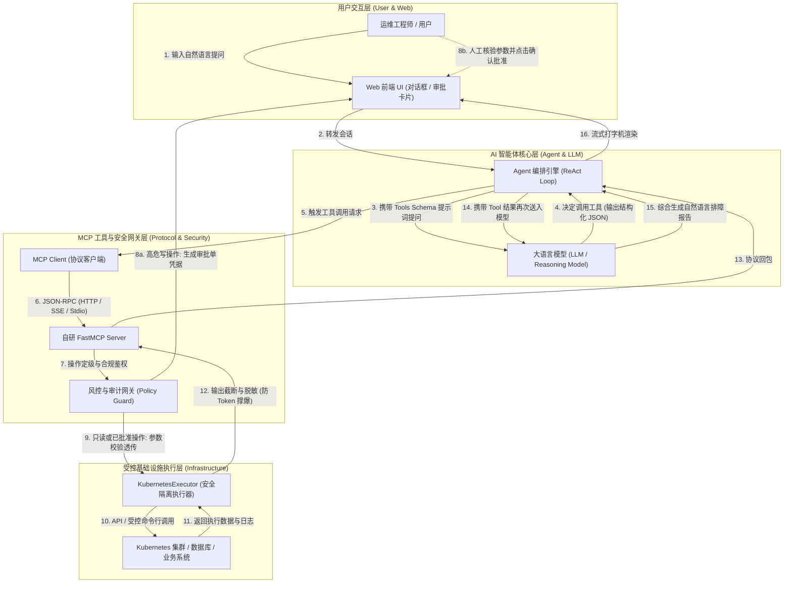

# AI智能体与自研MCP工具集成从零通关全景问答手册

> [!NOTE]
> 本文档面向从零接触 AI 工程化、智能体开发及工具集成的研发与 SRE 工程师，结合企业级运维平台（以 KubeDoor 架构为例），以模块化、层层递进的问答（Q&A）形式，彻底拆解大模型交互本质、Function Calling、ReAct 循环、MCP 协议全貌、风控审批与底层安全执行机制。

---

## 1. 业务背景与技术定位 (Context & Core Value)

在将大语言模型（LLM）引入实际生产项目（如自动化运维、私有知识库、DevOps 平台）的过程中，开发者最常面临的断层并非模型能力不足，而是**对 AI 与底层系统通信的原理性认知缺失**：
- 误以为“大模型能直接连 Kubernetes 集群或数据库”；
- 误以为“大模型自己会在后台跑 Python 或 Shell 脚本”；
- 面对复杂系统（如 KubeDoor）中的工具网关、通道分流（`kubedoor`/`direct`/`agent`）、FastMCP 协议及 Human-in-the-Loop（人机审批）流转时缺乏宏观心智模型。

本文档作为 AI 工具集成的“通识基石”，建立从基础概念到工程落地的完整知识图谱。

---

## 2. 核心架构与端到端交互拓扑 (Architecture Deep Dive)

以下是人类用户、AI 智能体、MCP 协议层与底层受控系统之间的标准端到端交互流转拓扑：



---

## 3. 模块一：大模型与工具调用的底层本质 (LLM & Tool Calling Basics)

### Q1：大语言模型（LLM）的本质是什么？为什么它不能直接帮我们查日志或重启服务？
**答**：
1. **本质是“文字接龙”（自回归概率预测）**：LLM 本质上是一个由数千亿权重参数组成的神经网络，输入一段 Token（词元），它根据统计概率预测并输出下一个最可能出现的 Token。
2. **知识截止期与封闭系统**：模型权重在训练完成那一刻就固定了，它内部没有网络连接、没有系统权限，无法感知此刻机器上的实时 CPU 使用率，也无法凭空知道集群当前的 Pod 状态。
3. **“幻觉”现象**：如果直接让模型猜“某个服务挂了的原因”，它会一本正经地编造出一个看似合理但完全不符合现实的伪日志。因此，必须为模型配备**外部双手与眼睛（工具）**。

---

### Q2：什么是 Function Calling（工具调用）？模型真的自己会“执行”代码吗？
**答**：
**绝对不会！大模型从始至终只负责输出文本。**
所谓的 Function Calling，真实过程如下：
1. **提供契约**：在请求模型时，开发者将本地函数的名称、作用、参数格式（以 JSON Schema 形式）写在 Prompt 或 API 的 `tools` 字段中告诉模型。
2. **模型决策**：模型分析用户提问（如“帮我查一下 default 下 crash 的 pod”），发现匹配到了 `get_pods` 工具，于是它**停止生成普通文本**，转而生成一段特殊的结构化 JSON 字符串：
   ```json
   {
     "name": "get_pods",
     "arguments": {"namespace": "default", "status": "CrashLoopBackOff"}
   }
   ```
3. **宿主执行**：你的后端 Python 程序截获这段 JSON，在本地安全环境中真正调用 `get_pods(namespace="default", ...)`。
4. **结果回传**：Python 程序把真实查询到的输出（如 `web-app-7b8c`）作为一条 `role: tool` 的消息塞回给模型，由模型最终组织成人话回答给用户。

---

### Q3：什么是 JSON Schema？为什么大模型能准确填写我需要的参数？
**答**：
JSON Schema 是一种用于标注和校验 JSON 数据结构的通用标准规范。
当你用 Python Pydantic 编写参数类型时：
```python
class PodQueryArgs(BaseModel):
    namespace: str = Field(..., description="目标命名空间，例如 prod 或 test")
    lines: int = Field(100, description="读取日志行数，默认 100")
```
后台框架（如 FastMCP / FastAPI）会将其自动转义为标准化描述：
```json
{
  "type": "object",
  "properties": {
    "namespace": {"type": "string", "description": "目标命名空间，例如 prod 或 test"},
    "lines": {"type": "integer", "default": 100, "description": "读取日志行数，默认 100"}
  },
  "required": ["namespace"]
}
```
**模型的语义理解能力**会阅读这些 `description` 与 `type`，像一个初级程序员按开发文档填参一样，把自然语言中提取到的实体（如“生产环境”）精准填充到 `namespace: "prod"`。

---

### Q4：什么是 Token 和 Context Window（上下文窗口）？为什么工具返回不能直接甩几万行日志？
**答**：
1. **Token（词元）**：大模型处理文本的基本计算单元。通常 1 个汉字约为 1~2 个 Token，英文单词约为 1 个 Token。调用商业模型均按 Token 数量计费。
2. **Context Window**：单次对话中模型能够同时容纳的 Token 上限（例如 32k、128k）。
3. **超长风险**：
   - **硬性溢出**：若工具调用一次性 dump 出了 50MB 的 Java 堆栈日志，请求会直接触发 HTTP 400（`context_length_exceeded`）崩溃；
   - **大海捞针遗忘（Lost in the Middle）**：上下文过长会导致模型注意力发散，忽略核心报错；
   - **高昂成本**：无效日志会成倍消耗 Token 费用。
4. **工程铁律**：自研工具内部必须实现**上限截断（Truncation）**（如限制 64KB / 默认 100 行）或在工具内部先做结构化正则过滤。

---

## 4. 模块二：AI 智能体（Agent）核心范式 (Agent & ReAct Loop)

### Q5：什么是 AI Agent（智能体）？与普通 ChatGPT 单轮对话有什么区别？
**答**：

| 维度 | 普通单轮/简单对话 (Chat) | AI 智能体 (Agent) |
| :--- | :--- | :--- |
| **交互深度** | 一问一答，模型回答完毕即结束 | 具备自主循环逻辑，可执行多步骤任务 |
| **工具使用** | 通常不挂载外部能力或仅单次调用 | 能根据前一步工具的返回结果，动态决定下一步工具 |
| **目标导向** | 被动响应当前输入 | 拥有长远目标（如“定位服务延迟高的根因并修复它”） |
| **自我纠错** | 工具报错时直接把报错返回给用户 | 能捕获工具报错，分析原因并修正参数重试 |

---

### Q6：什么是 ReAct 思考行动循环？请拆解一次排障过程的时序。
**答**：
ReAct 即 **Reasoning（推理）+ Acting（行动）**。其本质是一个状态机循环：

```
[Thought: 思考当前现状] --> [Action: 决定调用什么工具] --> [Observation: 观察工具执行结果]
          ▲                                                             │
          └───────────────────── (未达成目标，继续循环) ───────────────────┘
                                        │
                               (已找到原因或解决问题)
                                        ▼
                            [Final Answer: 输出最终总结]
```

**实战场景拆解**：
- **用户提问**：“订单服务支付超时，帮我排查原因。”
- **Round 1 (Thought)**：我需要先查看订单服务所在 Pod 的状态。
  - **Action**：调用 `get_pods(namespace="order", deployment="order-service")`
  - **Observation**：得到结果 `order-service-9d8a: OOMKilled, restarts: 5`
- **Round 2 (Thought)**：Pod 发生了内存溢出重启，我需要查看上一次崩溃前的日志。
  - **Action**：调用 `get_pods_logs(pod="order-service-9d8a", previous=true, lines=50)`
  - **Observation**：日志末尾显示 `java.lang.OutOfMemoryError: Java heap space`
- **Round 3 (Thought)**：已明确根因为 JVM 堆内存耗尽，当前无须再调工具。
  - **Final Answer**：向用户汇报：“订单服务发生 OOMKilled，日志证实堆内存耗尽，建议调大内存配额限制或优化大对象分配。”

---

### Q7：什么是 System Prompt？它是如何规范 Agent 不乱来的？
**答**：
System Prompt 是在所有对话历史之前注入的一段隐式指令，拥有最高行为准则权限。
在工具集成中，System Prompt 主要用来注入**边界安全与工具使用禁令**，例如：
- *“你是一名只读分析助手，严禁在未经用户明确要求时发起删除或重启操作。”*
- *“在调用变更操作前，必须先调用对应的查询工具验证目标资源真实存在。”*
- *“遇到敏感信息（密码、私钥、Token），必须在展示前打码处理。”*

---

## 5. 模块三：MCP (Model Context Protocol) 协议全景 (MCP Deep Dive)

### Q8：既然 OpenAI / 各模型已经有了 Function Calling，为什么还要 MCP？
**答**：
传统的 Function Calling 属于**“烟囱式私有集成”**：
- 如果你为 OpenAI 平台开发了一套 K8s 诊断工具，当团队要接入 Claude、Cursor、或自研开源模型（DeepSeek / Qwen）时，你必须把这套工具的适配代码为每个平台重写一遍。
- 工具的认证、鉴权、生命周期与长连接管理在各平台完全割裂。

**MCP（模型上下文协议）是由 Anthropic 主导推进的行业开放标准（类比语言服务协议 LSP）：**
- **统一标准**：工具开发者只需要编写一个符合 MCP 标准的 Server。
- **即插即用**：Claude Desktop、Antigravity IDE、Cursor、你的自研 Agent 只要实现了 MCP Client，就能一键挂载并调用该服务上的所有能力。

---

### Q9：MCP 协议中的 Tools、Resources、Prompts 三要素是什么关系？
**答**：

| 协议要素 | 本质特性 | 类比运维概念 | 典型应用示例 |
| :--- | :--- | :--- | :--- |
| **Tools (工具)** | **动态可执行**，带副作用或带动态入参 | 远程 API / 脚本 / CLI | `restart_deployment(name)`、`get_pod_logs(pod, lines)` |
| **Resources (资源)** | **静态/只读上下文**，通过 URI 读取 | 配置文件 / 知识库 / 架构图 | `config://cluster-topology`、`skills://kubedoor-k8s` |
| **Prompts (模板)** | **预置专家提示词模板**，带填充参数 | 运维 SOP / 标准排障引导语 | `prompts://root-cause-analysis?app=order` |

---

### Q10：FastMCP 是什么？它和普通的 FastAPI 有什么区别？
**答**：
- **FastAPI**：基于 ASGI 的通用 Web 框架，暴露的是标准的 RESTful HTTP 接口（`GET /api/users`, `POST /api/login`）。
- **FastMCP**：专为 MCP 协议打造的 Python 快速开发框架（类似 FastAPI 的优雅装饰器体验）。它封装了 JSON-RPC 2.0 序列化、工具 Schema 生成、Stdio 管道和 SSE/Streamable HTTP 传输协议。
- **协同关系**：在企业级应用中，通常将 FastMCP 作为一个子应用（Sub-Application）挂载到 FastAPI 之中，同一个服务既能提供前后端常规 REST API，又能提供 `/mcp` 与 `/sse` 给 AI 客户端。

---

## 6. 模块四：结合 KubeDoor 架构的企业级工程落地 (Production & Security)

### Q11：为什么在 KubeDoor 中，工具调用要区分 `kubedoor`、`direct`、`agent` 和 `auto` 来源？
**答**：
这是典型的多环境基础设施混合调用治理模型：
1. **`kubedoor`（平台接口优先）**：优先使用平台数据库已同步的历史快照、监控数据或业务 API（例如 Prometheus 汇总指标、定时任务注册接口）。优点是速度快、免穿透底层、审计完整。
2. **`direct`（直连 SDK）**：通过后端直连的 kubeconfig 调用 K8s OpenAPI。用于需要查询平台未同步的实时 CRD 或深度字段。
3. **`agent`（节点轻量代理）**：目标集群处于隔离网络或内网 VPC，AI 后端无法直连，此时通过部署在目标集群内常驻在线的 Agent 转发执行命令。
4. **`auto`（自动智能分流）**：普通业务运维优先走 `kubedoor`，无法满足时根据网络条件在 `direct` 与 `agent` 间自适应降级。

---

### Q12：什么是 Human-in-the-Loop（人机审批闭环）？它是如何防范 AI 删库跑路的？
**答**：
无论大模型多聪明，它都存在不可预知的概率性幻觉与误理解。**在工业级运维系统中，绝不能把“写操作”的全自动执行权限无条件赋予 AI。**

**审批流转的核心机制**：
1. **工具分为“只读”与“高危写”**：
   - 只读（`get`, `list`, `metrics`）：网关直接放行执行；
   - 高危写（`restart`, `scale`, `delete`, `update_image`）：网关执行**拦截与冻结**。
2. **生成不可篡改凭据**：网关提取该操作的完整参数（如 `deployment: order-service`, `replicas: 0`），生成唯一的 `ticket_id` 存入数据库或 Redis。
3. **中断等待（Yield / Suspend）**：MCP Tool 立即返回 `{"requires_approval": true, "ticket_id": "xxx", "approval_url": "..."}`。
4. **人工确认与执行**：前端界面渲染醒目的审批确认卡片，人类工程师核验参数差异无误后点击“批准”，系统才由后端服务真正下发变更指令。

---

### Q13：为什么自研工具中严禁 `os.system("kubectl " + cmd)` 这种拼接命令？
**答**：
这会引入严重的**命令注入漏洞（Command Injection）与 Prompt 注入攻击**。
- 如果恶意用户在聊天框输入：`帮我查看 pod 名称为：foo; rm -rf /; 的状态`；
- 模型若将 `foo; rm -rf /;` 作为参数传给工具，字符串拼接会导致系统执行灾难性指令；
- **正确规范**：必须使用**非交互式子进程参数列表**：
  ```python
  # 正确做法：严格使用数组参数，杜绝 shell 语法解析
  subprocess.run(["kubectl", "get", "pod", pod_name], shell=False)
  ```

---

## 7. 模块五：初学者动手学习路径与排错决策树 (Roadmap & Troubleshooting)

### 7.1 从零到一的实战四步走规划

```
第 1 周：基础重塑
掌握 Python Type Hints 与 Pydantic，理解 JSON Schema 与 OpenAI 基础 Function Calling 传参流程。

第 2 周：协议进阶
编写第一个本地 FastMCP Server (stdio 模式)，使用 Claude Desktop 或 FastMCP Dev Inspector 联调。

第 3 周：Agent 驱动
编写基于 AsyncIO 的 Agent 编排循环，通过 MCP Client 动态 list_tools 并处理 Tool 消息回填。

第 4 周：工程闭环
引入风险分类字典、审批拦截机制、输出截断与 FastAPI / Docker 生产化部署。
```

---

### 7.2 高频踩坑与排错排查表

| 报错现象 | 根本原因 | 解决与排查方案 |
| :--- | :--- | :--- |
| **HTTP 422 Unprocessable Entity** | 模型生成的参数类型与 Pydantic 约束不符（如需要 `int` 却传了字符串 `"3"`） | 检查 Tool 参数的 Pydantic 模型，增加容错解析逻辑或明确 `Field(description=...)` |
| **Context Length Exceeded (400)** | 工具返回结果体积过大（如 dump 了大量日志），撑爆上下文窗口 | 在工具执行器层强制添加 `MAX_BYTES` 截断逻辑，日志工具强制默认 `lines=100` |
| **MCP SSE 连接 60 秒频繁超时中断** | 反向代理（Nginx / Ingress）开启了响应缓冲或默认超时过短 | Nginx 配置中对 `/sse` 路径增加 `proxy_buffering off; proxy_read_timeout 600s;` |
| **模型死循环不停重复调用同一个工具** | 工具返回的错误信息过于晦涩，或者成功后未给出明确完成标记 | 在工具返回中包含明确语义的 `success: true` 与人类可读 summary，引导模型终止循环 |

---

## 8. 架构总结与思维导图 (Summary)

- **核心心智模型**：LLM 是“大脑”（决策思考），Prompt/Schema 是“神经信号传递契约”，MCP 是“通用接口标准”，Executor 与 Gateway 是“受控肌肉与风控保险丝”。
- **安全第一准则**：零信任原则，无审批不落地写操作，防拼接、做截断。

---

> [!TIP] 💡 关联技术与延伸阅读
>
> * [阶段一：API 与 FunctionCalling 学习资料](./阶段一_基础重塑_API与FunctionCalling学习资料.md)
> * [AI 智能体全局规范引擎与热加载机制深度解析](./29-AI智能体全局规范引擎与IDE热加载机制深度解析.md)
> * [Prompt Engineering 重点精读笔记](./PromptEngineeringGuide_重点精读笔记.md)
