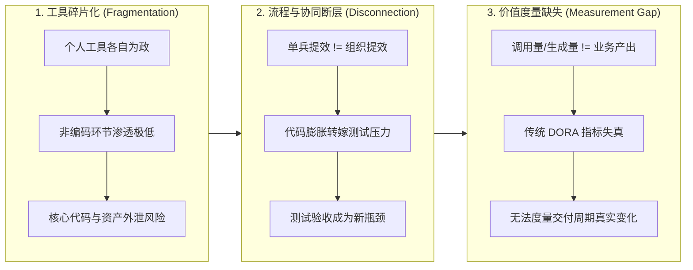
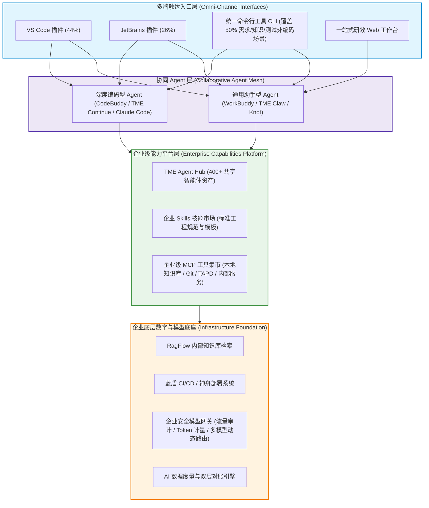
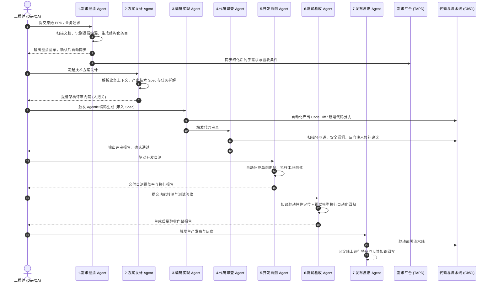
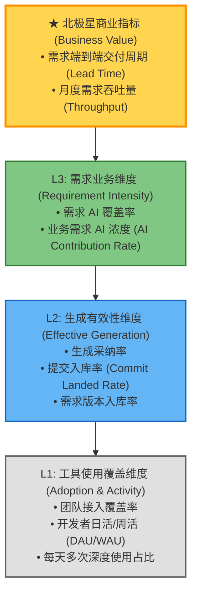
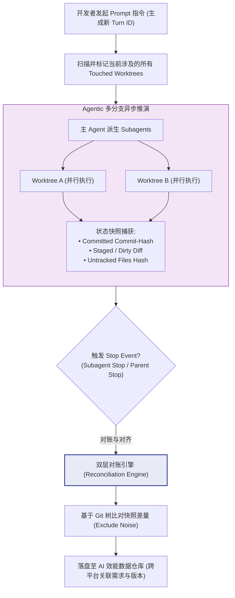

# 重构研发效率：企业级 AI Coding 研效体系搭建与价值度量全景实战

> [!NOTE]
> **原始参考来源**：[重构研发效率：AI Coding研效体系搭建与迭代之路](https://mp.weixin.qq.com/s/3XzZhaXVG83yMNg9IH7sSw)  
> **内容主讲**：李娟（腾讯音乐娱乐集团研发效能中心资深测开专家，MTSC 2026 大会分享）  
> **整理出品**：TesterHome 社区  
> 本文档基于腾讯音乐在 AI Coding 效能基建、全研发链路人机协同重构及代码入库价值度量领域的完整工业级落地实战，系统解构企业级 AI 研效体系从“单点工具尝试”跃迁至“全流程价值闭环”的核心架构、算法设计与工程实践。

---

## 1. 业务背景与体系痛点 (Context & Challenges)

### 1.1 从单点提效到组织沉淀的三大鸿沟
自 2023 年底开源代码大模型演进以及 2024 年各类 AI 辅助编程工具（Copilot、Cursor、Claude Code 等）集中爆发以来，研发团队普遍经历了从“个人尝鲜”到“团队推广”的过程。然而在企业级工程落地中，普遍暴露出三大结构性鸿沟：

- **挑战一：工具碎片化与合规安全孤岛**  
  多款商业与开源 AI 编码工具并行存在，开发者各选其好；但在需求、设计、测试等占据研发 50% 以上工时的非编码环节渗透率极低；同时缺乏统一的账号权限、审计机制和模型网关，面临企业核心源码和商业机密外泄的高危合规风险。个人调试出的优秀 Prompt/Agent 经验无法作为团队数字资产留存沉淀。
- **挑战二：流程断层与质量转嫁**  
  “写代码变快了，交付却没变快”。单点编码工具让代码产出速度成倍提升，但若没有统一的代码审查与自测规范，AI 生成的代码逻辑漏洞、低质冗余代码直接倾泻到下游测试环节，导致测试验收周期反而拉长，形成严重的流程反噬。
- **挑战三：价值难证与虚假繁荣**  
  企业管理者无法证明投入 AI 工具后究竟带来了多大的业务价值。“采纳率 30%”、“生成了 10 万行代码”等表面指标与业务价值脱节，甚至存在开发者通过生成脚手架和测试废弃代码“刷指标”的现象。无法准确识别哪些 AI 代码真正被合并入库并最终上线交付。

### 1.2 企业级破局的核心命题
为跨越上述鸿沟，企业级 AI Coding 体系建设必须回答好三个根本问题：
1. **基建层**：AI 如何在保证数据安全、合规审计与能力复用的前提下，成体系地进入企业？
2. **链路层**：AI 如何打破单点编码工具的边界，贯通需求、设计、编码、测试到发布的一站式全链路？
3. **度量层**：如何科学度量 AI 产生的“有效代码”，证明其真正缩短了端到端交付周期并提升了业务吞吐量？

---

## 2. 腾讯音乐 AI Coding 效能新基建 (Infrastructure & Platform)

### 2.1 跨越三道工程门槛
腾讯音乐研发效能团队在建设初期明确了必须跨越的三道核心门槛：
- **门槛 1：统一接入**  
  对外围引入的开源/商业 AI 工具进行深度改造，统一收口至内部单点登录（SSO）、权限控制中心、模型路由代理与合规审计日志中，实现源码不离企、模型按需切。
- **门槛 2：统一复用**  
  打造集团级共享中枢，包括 Agent Hub、Skills 技能市场与 MCP（Model Context Protocol）集市，使研发个体在实战中沉淀的架构模板、业务规范、上下文调试策略能够一键共享至全集团。
- **门槛 3：统一治理**  
  将 AI 能力全面打通内部 DevOps 资产体系（需求管理系统 TAPD、知识库 Iwiki、代码管理 Git、CI/CD 蓝盾流水线、监控告警），杜绝产生孤立的 AI 玩具。

### 2.2 效能新基建全景分层架构

### 2.3 关键技术选型考量：IDE 插件与 CLI 协同
- **IDE 分布适配**：内部数据显示，开发者使用的集成开发环境呈现高集约分布（VS Code 占比 44%，JetBrains 系列占比 26%）。因此通过深度定制双轨插件，无缝覆盖 70% 以上高频日常编码体验。
- **CLI 覆盖非编码与自动化场景**：开发者的完整工作链条中，约 50% 的时间处于非编写代码环节（如需求理解、设计文档梳理、复杂环境联调、用例批量生成与流水线回归）。IDE 插件对这些非图形化交互难以全量承载，为此打造统一的 **AI Coding CLI**，与 IDE 共享底层能力内核，实现一处编写规则，多入口即时触发。
- **治理成果**：通过搭建 TME Agent Hub 与标准化模板，累计孵化沉淀 **400+ 共享型业务与架构 Agent**，研发人员由过去配置互不相通、重复配置，实现了通用配置复用覆盖率由 **28% 跃升至 100%**。

---

## 3. AI 时代研发链路重构：人机协同与 7 阶段流转 (Workflow & Agentic Collaboration)

### 3.1 人机协同的分工与责任边界
在引入 Agentic 研发链路后，研发各维度的“变与不变”必须得到清晰界定：

| 维度 | AI 时代的变化 (What Changes) | 坚守不变的底线 (What Remains) |
| :--- | :--- | :--- |
| **代码生成** | 从 100% 手工编写逐行敲击，演变为人机协同 Prompt/Spec 引导下的自动化生成 | 业务逻辑的正确性、代码安全规范与交付稳定性标准不变 |
| **工程文档** | 从口头同步或零散隐性经验，转变为结构化 Markdown/Spec 机器可读文档 | 业务领域知识的严谨性与架构合理性要求不变 |
| **上下文维护** | 从临时在输入框零散“喂料”，演化为分阶段工程级的上下文沉淀与持久化 | 工程师作为业务第一责任人，对最终上线结果负责的权责边界不变 |

在协同分工上形成三层铁律：
1. **人类工程师（负责战略、判断与兜底）**：澄清深层业务意图、裁决架构路线选型、执行代码与用例关键评审，并承担最终交付与上线责任；
2. **人机协作（负责推演与拓界）**：利用大模型的多方案推演能力进行技术方案优劣对比、信息快速整合检索、复杂架构可行性探索；
3. **AI 智能体（负责执行边界明确的工程任务）**：根据明确的 Spec 生成代码骨架与业务函数、生成单元测试用例、自动执行本地构建与语法检测、修补静态分析缺陷。

### 3.2 一站式研发平台 7 节点流转架构

### 3.3 质量左移：“生成即验证”四道防线
传统研发过程中，缺陷大多在集成测试或预发环境暴露。在 AI Coding 体系下，由于代码生成吞吐量激增，必须推行**“生成即验证”的四级前置防御**：
1. **生成前（规则约束注入）**：在系统级 Prompt 中内嵌团队 P0/P1 级编码规范、架构限制与禁用 API 清单，从源头约束大模型的幻觉扩散；
2. **生成时（实时拦截）**：通过本地 Git Hook 与 IDE LSP 语言服务器进行实时静态语法与规范拦截，一旦触发 P0 级违规立即中断生成流程；
3. **生成即校验（用例同步补偿）**：代码生成完成后，AI 必须基于变更逻辑同步生成对应的单元测试用例，并在沙箱内执行，保证测试通过方可呈现给工程师；
4. **CI 后（云端深度扫描与自愈）**：代码推送到远程分支后，CI 云端流水线执行多引擎安全扫描与动态分析；若发现轻量级格式或常见并发隐患，由审查 Agent 自动提交包含修复补丁的 Merge Request，实现缺陷自愈。

### 3.4 知识驱动的自动化 UAT 验收闭环
针对前端与客户端 UI 容易变更、传统基于绝对坐标或 XPath 自动化脚本极易断裂的痛点，采用**“双模驱动”技术方案**：
- **模式 A：确定性控件标签定位**  
  在工程构建阶段为关键控件自动注入业务语义标签（Data-Test-ID），用于主流稳定链路的高速精确回放；
- **模式 B：视觉小模型 + 动态渲染识别（Maestro / Midscene）**  
  遇到动态变更或复杂 Canvas/跨平台组件时，调用多模态视觉小模型直接理解屏幕截图上的文本、按钮图标与逻辑布局，自主推演点击与滑动手势；
- **全闭环流程**：形成“测试用例生成 $\rightarrow$ 自动化执行取证 $\rightarrow$ 缺陷任务自动指派 $\rightarrow$ 质量门禁自动阻断 $\rightarrow$ 失败用例经验回写知识库”的完整工程飞轮。

### 3.5 试点落地成效
通过在腾讯音乐典型业务团队（主要覆盖迭代周期为 3 天以内的敏捷特性开发，该类需求在总体研效中占比约 60%）试点：
- 角色间的协同等待与口头拉齐时间大幅下降 **83%**；
- 月度需求吞吐量整体提升 **56%**，有效化解了“编码快、转测慢、协同拖”的结构性矛盾。

---

## 4. AI Coding 提效度量体系建设与有效代码算法 (Metrics & Effective Code Algorithm)

### 4.1 四级指标全景模型 (The 4-Level Metrics Framework)
为了真实反映 AI 的生产力转化，彻底告别“虚假繁荣”，腾讯音乐构建了由浅入深、层层递进的四级度量体系：

- **L1 使用覆盖**：评估工具推广态势（如实测 64.8% 开发者高频接入，其中 45.7% 的用户每天发起多次深度协同）；
- **L2 生成有效**：从单次生成的代码中识别真实被保留、被合并到主干的代码行比例；
- **L3 需求浓度**：在特定的业务需求维度，计算整个需求交付过程中由 AI 驱动完成的工时与代码比例；
- **L4 北极星指标**：最终锚定在业务是否按时保质交付、交付周期是否实质性压缩。

---

### 4.2 Agentic Coding 时代的采集困局与“双层对账”采集方案

#### 4.2.1 传统采集机制的失效
在传统单点 Copilot 时代，代码采集仅依赖客户端 IDE 插件监听单次补全弹窗的“接受（Tab）”或“拒绝（Esc）”事件，逻辑简单。但在现代 **Agentic Coding** 模式下（如 Claude Code、Cursor Agent、多智能体协同），研发行为发生了质的跃迁：
1. **多 Subagent 并发分叉**：一个主 Agent 派生出多个子任务 Subagent，在后台创建各自独立的 Git Worktree 或临时工作区进行并行推演；
2. **状态极其复杂**：子 Agent 在生成代码后，工作区存在 `committed`（已提交）、`dirty`（暂存未提交）以及 `untracked`（新增未跟踪文件）等多种状态；
3. **回滚与重试频繁**：若子 Agent 自测失败，会自动丢弃当前 Worktree 重新来过，导致传统的单点事件监听采集完全断层或重复虚高。

#### 4.2.2 基于 Turn 与 Worktree 的双层对账采集模型
为解决这一工程难题，设计了**“以会话轮次（Turn）为身份、以被触达工作区（Touched Worktree）为范围、以停止事件（Stop Event）为恢复点”**的双层对账采集机制：

- **Turn ID 贯穿**：每一个用户发起的意图被赋予全局唯一 Turn 标识，所有派生的后台 Subagent 必须显式继承该上下文；
- **快照比对对账**：在每次子 Agent 结束（Subagent Stop）或父 Agent 交付（Parent Stop）时，对账引擎瞬间对工作区的全部文件生成指纹树，将最终沉淀的代码差量与原始代码做三向比对，彻底剔除内部重试和自毁代码。

---

### 4.3 有效代码识别算法：四层匹配策略 (Effective Code Matching)

为了从海量提交中精准剥离出“真正源自 AI 且被人工接受”的有效代码行，杜绝把依赖包升级、脚手架自动生成或简单格式化混入统计，设计了严密的**四层递进式算法匹配流水线**：

```mermaid
flowchart LR
    InputDiff["Git Commit 代码差量 (Raw Diff)"] --> FilterNoise["第 0 步: 过滤依赖与非逻辑噪声<br/>(node_modules, dist, lock, .min.js 等)"]
    
    FilterNoise --> Step1["第 1 层: 字符长度 Diff 极速预筛<br/>(过滤长度偏差过大的无效候选)"]
    
    Step1 --> Step2["第 2 层: 字符串 Hash 严格完全匹配<br/>(快速收敛未改动的 AI 生成行)"]
    
    Step2 --> Step3["第 3 层: 词元 Jaccard 相似度预过滤<br/>(滑动窗口过滤语义严重偏离行)"]
    
    Step3 --> Step4["第 4 层: 动态规划字符级 LCS 精确匹配<br/>(精确判定人工局部修改后的有效 AI 代码行)"]
    
    Step4 --> ValidOutput["输出: 真实 AI 有效入库代码行 (Effective Lines)"]

    style FilterNoise fill:#ffcdd2,stroke:#c62828,stroke-width:1px
    style Step2 fill:#c8e6c9,stroke:#2e7d32,stroke-width:1px
    style Step4 fill:#bbdefb,stroke:#1565c0,stroke-width:2px
    style ValidOutput fill:#fff9c4,stroke:#fbc02d,stroke-width:2px
```

#### 算法详细逻辑剖析：
1. **第 0 步：非逻辑文件噪声熔断过滤**  
   严格排查非人工编写与依赖配置文件：
   - 依赖目录与锁定文件：`node_modules/`、`vendor/`、`package-lock.json`、`yarn.lock`、`go.sum`；
   - 编译制品与混淆资源：`dist/`、`build/`、`*.min.js`、`*.map`、`*.pb.go`；
   - 纯二进制文件与自动生成资源字典。
2. **第 1 层：长度差差分预过滤 (Length-Diff Fast Elimination)**  
   对候选提交行与 AI 建议行计算绝对长度差异：
   $$\Delta L = | \text{Len}(Line_{\text{commit}}) - \text{Len}(Line_{\text{ai}}) |$$
   若 $\Delta L$ 超过设定的动态比例阈值（如超过 50% 且绝对差异超过 30 字符），判定为完全重写，直接跳过，大幅降低后续高计算量操作。
3. **第 2 层：完全一致哈希碰撞 (Exact Hash Matching)**  
   对去除首尾空白符后的代码行计算 SHA-256，命中即判定为纯 AI 生成行，耗时 $O(1)$。在高质量生成场景下，约 60% 的有效代码在这一层被快速确认。
4. **第 3 层：Jaccard 词元集合重合度预过滤 (Jaccard Token Pre-Filtering)**  
   将代码行拆解为语法 Token（变量名、关键字、操作符）：
   $$J(T_{\text{commit}}, T_{\text{ai}}) = \frac{|T_{\text{commit}} \cap T_{\text{ai}}|}{|T_{\text{commit}} \cup T_{\text{ai}}|}$$
   仅当 $J \ge 0.6$ 时才将该行送入最后一层深层动态规划，避免对明显不相关的两行进行昂贵的最长公共子序列计算。
5. **第 4 层：动态规划字符级最长公共子序列 (LCS String-Level DP)**  
   当开发者对 AI 生成的代码进行了微调（如更改变量名、微调参数、补充类型注释），通过经典二维动态规划算法计算两者的公共字符占比：
   $$\text{Ratio} = \frac{2 \times \text{LCS}(S_{\text{commit}}, S_{\text{ai}})}{\text{Len}(S_{\text{commit}}) + \text{Len}(S_{\text{ai}})}$$
   当 $\text{Ratio} \ge 0.75$ 时，判定该行为“AI 辅助有效采纳行”，并按比例计入 AI 贡献权重。

### 4.4 跨系统数据融合与需求 AI 入库率
- **全链路数据对齐**：通过将三方系统数据在数据仓库中关联：
  - 代码仓库 Git Commit 日志（提供 Commit ID、Committer、变更行）；
  - AI 采集平台数据底座（提供 Turn ID、Prompt 记录、原始建议 Diff）；
  - 研发敏捷管理平台 TAPD（提供需求 ID、发布版本 Release、需求上线时间）。
- **核算公式**：
  $$\text{需求 AI 入库率} = \frac{\sum \text{该需求关联上线 Commit 中的有效 AI 代码行数}}{\sum \text{该需求关联上线 Commit 的总有效逻辑变更行数}} \times 100\%$$
- **实战数据成果**：在腾讯音乐落地试点的核心业务需求中，**需求级别的 AI 最终有效入库率超过 90%**，真正用硬核、可审计、防作弊的数据证明了 AI 对业务生产的真实支撑力度。

---

## 5. 生产落地总结、实战避坑与未来展望 (Summary & Future)

### 5.1 核心落地洞见
1. **代码提效 $\ne$ 交付提效**：单纯加快编写代码的速度，只会将瓶颈从“编码期”转移到“等待期”、“评审期”与“测试验收期”。必须通过统一的一站式平台将研发上下游角色串联起来，推行“生成即验证”，才能真正缩短交付周期。
2. **基建是组织级复用的前提**：严禁放任研发个人去摸索和割裂使用孤立工具。通过统一安全接入网关、打造 Agent Hub 与 MCP 工具市场，把单兵实战经验转化为企业级数字资产，覆盖率才能实现从 28% 到 100% 的质变。
3. **度量是指引飞轮正向运转的舵手**：摒弃“生成代码行数”、“Prompt 调用次数”等易被作弊和刷量的虚荣指标，通过**Turn 级双层对账采集**与**四层匹配算法**，紧密锚定业务需求交付周期与有效入库率，实现“度量 $\rightarrow$ 发现瓶颈 $\rightarrow$ 优化 Agent 策略 $\rightarrow$ 再次度量”的正向闭环。

### 5.2 企业级落地避坑指南 (Pitfall Prevention)

| 典型踩坑场景 | 表现与危害 | 应对治理方案与架构约束 |
| :--- | :--- | :--- |
| **虚假内卷“刷行数”** | 开发者诱导 AI 大量生成无用的胶水代码、脚手架或冗余注释以提升“AI 产出指标” | 强制启用四层有效代码识别算法，自动过滤非逻辑文件与低质量冗余行，与代码复杂度指标联动 |
| **测试反噬与缺陷转嫁** | AI 快速生成大量未经检验的代码推向下游，导致 QA 团队测试周期成倍拉长 | 设立“生成即验证”质量红线，AI 生成代码必须捆绑自动生成的单元测试用例，并在云端流水线设置质量门禁 |
| **Prompt 与 Agent 资产孤岛** | 架构师与资深开发各自私藏优质 Prompt，新人重复踩坑且水平参差不齐 | 建立统一的 TME Agent Hub 与 Skills 共享集市，实行评分、版本控制与一键复用机制 |
| **源码外泄与合规风险** | 内部工程代码通过未受控的外部插件直接请求公网大模型接口 | 统一走企业级反向模型网关，落地代码脱敏、IP 白名单鉴权与全链路 Token 调用审计日志 |

### 5.3 展望：迈向自主进化的软件工程智能体 (Self-Evolving SWE)
从辅助补全（Copilot）到人机协同（Pair Agent），再到如今的一站式全流程协同（Agentic Workflow），未来的企业级软件工程将进一步向自主进化演进：
- **深度端到端自主工程**：由智能体自主阅读历史 PRD 与架构图，完成环境准备、编码、自测、部署与灰度观测；
- **知识库闭环自迭代**：线上出现的每一个故障 RCA 复盘结果，将自动反哺转译为 Agent 的防踩坑规则库与前置拦截门禁，构建真正具备“自我免疫与自我修复”能力的高韧性工程研效底座。

---

## 6. 原始参考与延伸阅读 (References)

### 6.1 外部溯源信息
- **原始文章链接**：[重构研发效率：AI Coding研效体系搭建与迭代之路](https://mp.weixin.qq.com/s/3XzZhaXVG83yMNg9IH7sSw)
- **大会与主讲背景**：MTSC 2026 第十五届中国互联网测试开发大会，腾讯音乐娱乐集团（TME）研发效能中心资深测试开发专家 李娟。

---

> [!TIP] 💡 关联技术与延伸阅读
>
> * **协同流程基座**：[`./01-禅道项目管理与DevOps全景指南-角色协同与功能架构深度实践.md`](./01-禅道项目管理与DevOps全景指南-角色协同与功能架构深度实践.md) —— 解构研发角色权责矩阵与传统 DevOps 链路
> * **规范与热加载机制**：[`../../04-AI/29-AI智能体全局规范引擎与IDE热加载机制深度解析.md`](../../04-AI/29-AI智能体全局规范引擎与IDE热加载机制深度解析.md) —— 探索智能体全局规则下发与 IDE 即时协同底层原理
> * **MCP 工具集成实战**：[`../../04-AI/32-AI智能体与自研MCP工具集成从零通关全景问答手册.md`](../../04-AI/32-AI智能体与自研MCP工具集成从零通关全景问答手册.md) —— 企业级 MCP 工具集市落地核心与开发答疑
> * **MLOps 交付体系**：[`../../04-AI/31-MLOps工程化架构全景与生产落地实战指南.md`](../../04-AI/31-MLOps工程化架构全景与生产落地实战指南.md) —— 大模型企业级工程化交付、模型网关与治理全景
