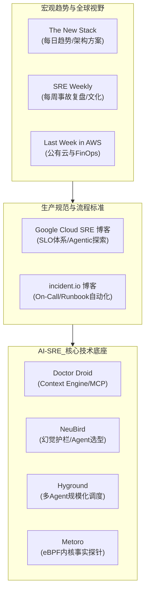

# 全球顶级 SRE、DevOps 与 AI-Ops 前沿周刊及核心博客精选指南

> [!NOTE]
> **原始参考来源**：
> - [SRE Weekly](https://sreweekly.com/) - 精选有关可扩展性、可用性、事件响应和自动化的资讯简报
> - [Last Week in AWS](https://www.lastweekinaws.com/) - Corey Quinn 的每周 AWS 新闻、评论与云账单解剖
> - [Google Cloud DevOps 和 SRE 博客](https://cloud.google.com/blog/products/devops-sre) - 大规模 DevOps 和 SRE 的实践和工具
> - [The New Stack](https://thenewstack.io/) - 涵盖云原生技术，并包含丰富的 AI 和 SRE 专题
> - [incident.io 博客](https://incident.io/blog) - 实用的事故响应、On-Call 与 AI 工具落地内容
> - [Doctor Droid Notes](https://notes.drdroid.io/) - 专注于人工智能与知识图谱的 SRE 工程博客
> - [NeuBird 博客](https://neubird.ai/blog) - GenAI SRE 趋势预测、企业级护栏与行业深度分析
> - [Metoro 博客](https://metoro.io/blog) - 基于 eBPF 的 Kubernetes 可观测性与 AI SRE 内容
> - [Hyground 博客](https://hyground.ai/blog) - AI SRE、基础设施韧性、GenAI 规模化运行与安全内容

---

## 1. 调研背景与核心结论

随着大型语言模型（LLM）与自动化基础设施的深度融合，全球运维体系正经历从 **“被动告警响应” $\rightarrow$ “确定性代码自动化 (Deterministic Automation)” $\rightarrow$ “认知型智能体与闭环自愈 (Agentic SRE)”** 的关键跨越。

为了建立面向企业级生产环境的系统性学习体系，对业界主流的 9 个核心站点进行了全量调研与持续追踪核验。

### 🔍 9 大站点存活与更新状态总览

| 序号 | 站点名称 | 领域归属 | 当前更新状态 | 更新频率 | 2026 前沿重点关注方向 |
| :---: | :--- | :--- | :---: | :---: | :--- |
| **01** | **SRE Weekly** | 综合 SRE / 混沌工程 / 事故文化 | 🟢 持续更新 | 每周 1 期 (525+ 期) | AI 编码助手引发的新型线上故障、Human-in-the-loop 审核断层、高质量 Postmortem |
| **02** | **Last Week in AWS** | AWS 云生态 / FinOps / 架构评析 | 🟢 持续更新 | 每周多次 (周刊+播客) | Aurora / S3 / CloudFront 新特性、Amazon Q 实战效能、云账单避坑陷阱 |
| **03** | **Google Cloud DevOps & SRE** | 企业级 SRE 体系 / 架构韧性 | 🟢 持续更新 | 每月 1~2 篇深度专栏 | Google SRE 内部落地 Agentic AI 规范、多区域控制面事故处置、MLOps 可靠性 |
| **04** | **The New Stack** | 云原生综合 / 平台工程 / AI 运维 | 🟢 持续更新 | 每日高频更新 | Autonomous SRE 三阶段演进、Azure SRE Agent 生产实践、平台工程与工具收敛 |
| **05** | **incident.io 博客** | 事故响应 / On-Call 治理 / 协作 | 🟢 持续更新 | 每周 1~3 篇 | On-Call 疲劳消除最佳实践、2026 自动化 Runbook 工具选型、ChatOps 流程度量 |
| **06** | **Doctor Droid Notes** | AI 辅助排障 / 知识图谱 / 上下文 | 🟢 持续更新 | 每月 2~4 篇 | SRE Context Engine（生产知识图谱）、MCP 协议对接 IDE 与排障 Agent、Playbook 编排 |
| **07** | **NeuBird 博客** | GenAI SRE / 智能体护栏 / 架构防错 | 🟢 持续更新 | 每月 2~3 篇 | 2026 年 Top 20 AI SRE 选型、防幻觉护栏（Hallucination Guardrails）、告警大屏疲劳治理 |
| **08** | **Metoro 博客** | eBPF 内核探测 / K8s 可观测性 | 🟢 持续更新 | 每月 2~3 篇 | eBPF 零侵入 L7 流量与 TLS 抓包、内核级客观事实注入 AI Agent、毫秒级 RCA 定位 |
| **09** | **Hyground 博客** | 自主 Agent / 主权 AI / 韧性系统 | 🟢 持续更新 | 每月 1~2 篇 | 万级规模 IT 运维 Agent 集群调度、企业级 AgentOps 架构、AI 驱动的线上回归测试 |

---

## 2. 站点深度解构与学习价值评估

### 2.1 资讯与宏观演进类 (General News & Industry Pulse)

#### 📰 01. SRE Weekly (SRE 周刊)
- **站点地址**：[https://sreweekly.com/](https://sreweekly.com/)
- **主理人**：Lex Neva (业内知名 SRE 领航人)
- **内容定位**：自 SRE 概念诞生以来全球最具影响力的周刊，精选全球范围内关于高可用设计、网络瘫痪事故复盘、自动化工具与混沌工程的优质文章。
- **深度特色**：
  - 每期不仅有工具推荐，更关注**“组织文化与复盘反思”**（如近期关于复盘流于形式的探讨《The Treachery of Postmortems》）；
  - 敏锐捕捉 AI 编码引入的生产隐患（如 AI 生成的代码破坏数据库约束、AI Agent 隐蔽触发故障等）。
- **学习推荐度**：⭐⭐⭐⭐⭐（适合每周一早读，掌握全球 SRE 事故热点与思维模型）。

#### ☁️ 02. Last Week in AWS (Corey Quinn)
- **站点地址**：[https://www.lastweekinaws.com/](https://www.lastweekinaws.com/)
- **主理人**：Corey Quinn（Duckbill Group 首席云经济学家）
- **内容定位**：去除官方公关辞令，以犀利幽默的笔触点评 AWS 每一项新功能发布，深度拆解公有云计费与架构设计陷阱。
- **深度特色**：
  - 包含 Newsletter、*AWS Morning Brief* 以及 *Screaming in the Cloud* 顶级播客；
  - 聚焦**云原生底层成本治理（FinOps）**与架构冗余设计，深入探讨如 Aurora Global Database、EC2 Graviton 算力及跨区域流量成本。
- **学习推荐度**：⭐⭐⭐⭐⭐（公有云架构师、SRE 与 FinOps 工程师必读）。

#### 🌐 04. The New Stack (新堆栈)
- **站点地址**：[https://thenewstack.io/](https://thenewstack.io/)
- **内容定位**：全球云原生与底层基础架构第一科技媒体，覆盖 Kubernetes、服务网格、CI/CD、观测性与 AI 基础设施。
- **深度特色**：
  - 设立了独立的 **AI Operations** 与 **DevOps** 专题专栏；
  - 文章质量极高，多由一线大厂首席架构师撰写，深入剖析如《AI SRE Agent Autonomy: Three Phases of Incident Response》、《Agents operate, humans govern》等前沿方法论。
- **学习推荐度**：⭐⭐⭐⭐⭐（构建架构全局视野、技术选型与撰写深度设计方案的技术智库）。

---

### 2.2 官方最佳实践与事故编排类 (Enterprise SRE & Incident Response)

#### 🏛️ 03. Google Cloud DevOps 和 SRE 博客
- **站点地址**：[https://cloud.google.com/blog/products/devops-sre](https://cloud.google.com/blog/products/devops-sre)
- **出品机构**：Google 官方 SRE 架构团队
- **内容定位**：SRE“圣经”发源地，输出 Google 级的大规模可用性工程（CRE）、SLI/SLO 错误预算管理、无指责复盘以及云平台容灾实践。
- **深度特色**：
  - **前沿实践落地**：2026 年重磅分享了 Google 内部如何从“确定性脚本”转向“Agentic AI（智能体体系）”协助 SRE 巡检排障；
  - 聚焦多区域控制面故障容灾（Multi-region Disaster Recovery）与混沌工程生产标准。
- **学习推荐度**：⭐⭐⭐⭐⭐（SRE 体系化建设、设计 SLO 准入与应急响应规范的标准参考）。

#### 🚨 05. incident.io 博客
- **站点地址**：[https://incident.io/blog](https://incident.io/blog)
- **出品机构**：incident.io 创始团队
- **内容定位**：将事故管理（Incident Management）工程化、现代化的先锋平台。内容涵盖值班轮转、告警降噪、自动化 SOP 编排。
- **深度特色**：
  - 实操性极强，提供如《On-call best practices: handoffs, schedules, and alert fatigue》及《Runbook automation tools》等生产级落地模板；
  - 剖析如何通过与 Slack / Teams 深度绑定打造即时“战情室”，减少一线值班人员的认知负荷。
- **学习推荐度**：⭐⭐⭐⭐（制定团队 On-Call 轮值 SOP、事故分级与复盘机制时的绝佳参考）。

---

### 2.3 AI 智能体与认知型排障类 (AI-Agent & Cognitive SRE)

#### 🤖 06. Doctor Droid Notes
- **站点地址**：[https://notes.drdroid.io/](https://notes.drdroid.io/)（官网：[https://drdroid.io/](https://drdroid.io/)）
- **出品机构**：Doctor Droid（YC 孵化，AI SRE 调查智能体领军者）
- **内容定位**：致力于打造 SRE 的“AI 副驾驶/虚拟同事”，专注于事故调查（Investigation）、拓扑关联与根因自动化推导。
- **深度特色**：
  - **Context Engine（系统上下文引擎）**：深入探讨如何将分散在 Datadog、Prometheus、Kubernetes 中的指标与部署历史构建为动态知识图谱；
  - **MCP（Model Context Protocol）实战**：率先落地了生产排障的只读 MCP Server，使智能体能够在 IDE（如 Cursor、Claude）中安全调取可观测性事实。
- **学习推荐度**：⭐⭐⭐⭐⭐（研究 AI Agent 排障逻辑、MCP 落地、知识图谱关联分析必学）。

#### 🛡️ 07. NeuBird 博客
- **站点地址**：[https://neubird.ai/blog](https://neubird.ai/blog)
- **出品机构**：NeuBird（企业级 Production Ops Agent 平台）
- **内容定位**：聚焦生成式 AI 在 SRE 中的工程化落地，尤其是生产环境“安全边界”与“大模型幻觉防范”。
- **深度特色**：
  - 深度论证为什么在 SRE 领域 **“上下文检索精准度 (Context) 远比底层大模型参数规模更关键”**；
  - 提出防幻觉护栏机制（Hallucination Guardrails），并定期梳理《Top 20 AI SRE Tools in 2026》等生态全景。
- **学习推荐度**：⭐⭐⭐⭐（设计企业级 SRE 智能体准入机制与安全红线必读）。

#### 🧩 09. Hyground 博客
- **站点地址**：[https://hyground.ai/blog](https://hyground.ai/blog)
- **出品机构**：Hyground 团队
- **内容定位**：专注于基础设施自治（Autonomous Operations）、主权 AI（Sovereign AI）与超大规模系统运维智能体调度。
- **深度特色**：
  - 探讨上万级容器工作负载场景下，多 Agent 协同运维的规模化调度模型；
  - 剖析从 AIOps 迈向企业级 AgentOps 的架构转型瓶颈。
- **学习推荐度**：⭐⭐⭐⭐（研究超大规模微服务集群多智能体协同机制的参考源）。

---

### 2.4 内核级可观测性与事实驱动类 (eBPF & Kernel-Level Observability)

#### 🔬 08. Metoro 博客
- **站点地址**：[https://metoro.io/blog](https://metoro.io/blog)
- **出品机构**：Metoro（基于 eBPF 的 K8s AI SRE 平台）
- **内容定位**：主张“零插桩（Zero-Instrumentation）”，借助 Linux 内核 eBPF 技术采集网络、进程、系统调用与明文通信，为 AI 排障提供坚实的客观事实。
- **深度特色**：
  - 深入剖析 eBPF 在 L7 协议解析（HTTP/gRPC/MySQL/Redis）与 TLS 握手抓包中的低损耗实现；
  - 揭示底层指标与上层 LLM 推断的联动机制：利用内核事实消除传统日志/指标不足导致的 AI 误判。
- **学习推荐度**：⭐⭐⭐⭐⭐（Kubernetes 底层网络排障、eBPF 监控与硬核可观测性必读）。

---

## 3. 体系化学习路线与吸收建议

### 建议学习落地节奏
1. **周度动态跟进（轻量泛读）**：
   - 每周一查阅 **SRE Weekly** 与 **Last Week in AWS**，记录当周全球典型线上事故与架构教训。
2. **月度技术攻坚（深度精读）**：
   - 重点精读 **Google Cloud SRE** 与 **The New Stack** 的专题架构文章；
   - 追踪 **Doctor Droid** 与 **Metoro** 的实战代码与架构原理（尤其是 eBPF 与 MCP 在排障中的实操）。
3. **输出转化闭环**：
   - 将有价值的真实事故案例沉淀为知识库 `06_Troubleshooting/` 事故复盘；
   - 将前沿架构理念（如 MCP 协议、Context Engine、eBPF 零侵入采集）提炼为 `01_Inbox/` 的深度技术专题。

---

## 4. 原始链接溯源索引 (References)

| 平台 / 机构 | 原始完整 URL | 重点订阅渠道 / 格式 |
| :--- | :--- | :--- |
| **SRE Weekly** | [https://sreweekly.com/](https://sreweekly.com/) | Web / 邮件周刊 / RSS (`https://sreweekly.com/feed/`) |
| **Last Week in AWS** | [https://www.lastweekinaws.com/](https://www.lastweekinaws.com/) | Web / 邮件周刊 / Podcast 播客 |
| **Google Cloud DevOps & SRE** | [https://cloud.google.com/blog/products/devops-sre](https://cloud.google.com/blog/products/devops-sre) | Google Cloud Blog 官方专栏 |
| **The New Stack** | [https://thenewstack.io/](https://thenewstack.io/) | Web / 专栏 RSS / AI Operations Category |
| **incident.io Blog** | [https://incident.io/blog](https://incident.io/blog) | 官方技术博客 / Buyer's Guides |
| **Doctor Droid Notes** | [https://notes.drdroid.io/](https://notes.drdroid.io/) | Substack / Engineering Notes |
| **NeuBird Blog** | [https://neubird.ai/blog](https://neubird.ai/blog) | 官方架构博客 / 白皮书报告 |
| **Metoro Blog** | [https://metoro.io/blog](https://metoro.io/blog) | 官方技术博客 / eBPF 系列专栏 |
| **Hyground Blog** | [https://hyground.ai/blog](https://hyground.ai/blog) | 官方技术博客 / AgentOps 专栏 |

---

> [!TIP] 💡 关联技术与延伸阅读
>
> * [研发效能与协作流程规范](../02-研发效能与协作流程/README.md)
> * [AI 智能体全局规范引擎与动态加载体系](../../04-AI/29-AI智能体全局规范引擎与IDE热加载机制深度解析.md)
> * [待研究选题与攻坚灵感看板 (Research Backlog)](../../../03_Study_Plans/01_Research_Backlog/BACKLOG.md)
> * [生产事故 RCA 复盘与诊断决策树](../../../06_Troubleshooting/README.md)
