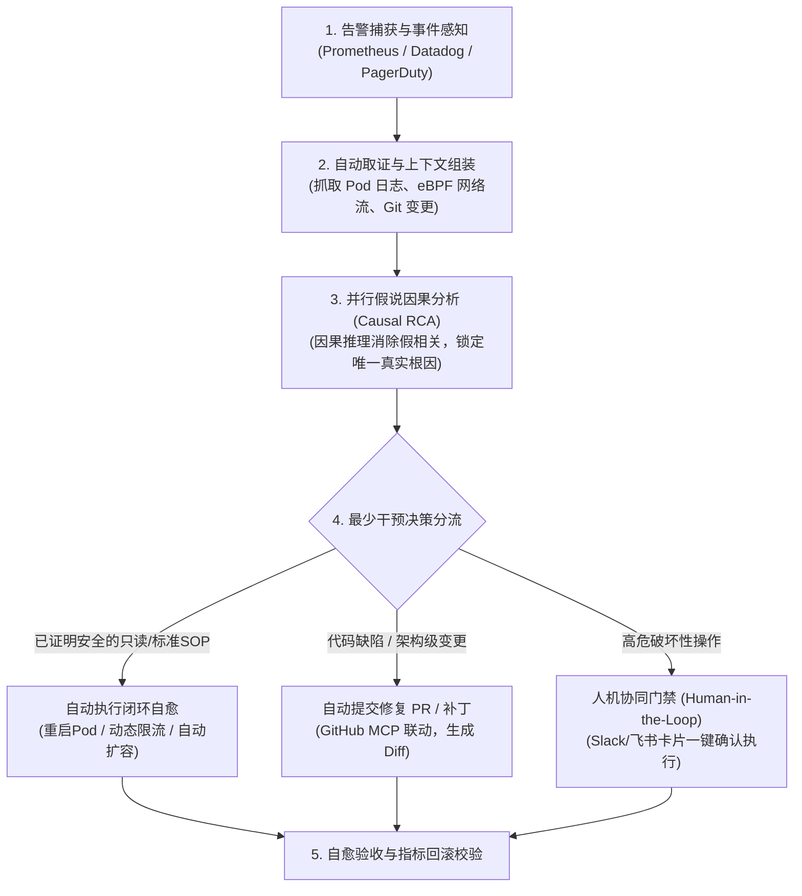

# 自主 AI-SRE 智能体技术选型与闭环自愈全景剖析 (Autonomous SRE Agents)

> [!NOTE]
> **原始参考来源**：
> - 核心收录仓库：[agamm/awesome-ai-sre](https://github.com/agamm/awesome-ai-sre/blob/main/README.md)
> - 核心调研主题：**自主 AI 代理（Autonomous AI Agents）** —— 告警自主取证调查、因果根因分析（RCA），以及在最少人工干预（Minimal Human Intervention）下的线上事件闭环修复。

---

## 1. 业务痛点与“自主智能体 (Autonomous Agent)”的核心范式

在传统微服务与云原生架构下，SRE 面临三大瓶颈：
1. **告警风暴与上下文缺失**：一次底层网络波动触发上百条下游微服务告警，人工值班（On-Call）需要花费 80% 的时间在查日志、对指标与问同事；
2. **多源证据链分散**：APM 调用链（Trace）、Prometheus 指标、K8s Events、代码 Git Commit 彼此割裂；
3. **修复动作滞后且易误操作**：即使查明原因，从编写脚本、手动回滚、提代码补丁到验证恢复往往耗时数十分钟甚至数小时。

### 🎯 自主 AI SRE 智能体的标准闭环工作流 (The OODA Loop)

优秀的自主 SRE Agent 必须具备以下四大核心能力闭环：



---

## 2. Awesome AI SRE 核心“自主 Agent”横向全景解构

`agamm/awesome-ai-sre` 收录的 28 款专门自主 SRE 代理中，按**底层技术路线与干预模式**可划分为四大阵营：

### 2.1 阵营一：代码级自愈与自动提 PR 智能体 (Code & Pipeline Auto-Remediation)
*主打能力：不仅定位到基础设施，还能精确定位到 Bug 代码行，自动编写修复 Patch 并提交 PR。*

| 项目名称 | 核心机制与架构特色 | 自愈/干预程度 | 开源/部署模式 |
| :--- | :--- | :--- | :--- |
| **[Middleware OpsAI](https://middleware.io/product/ops-ai/)** | 贯通 APM、RUM、日志与 K8s 全链路。通过 **GitHub MCP** 协议直接将运行期堆栈反查映射到代码仓库的具体行数，自动生成 Bugfix PR；对于 K8s 资源配置级故障可自动热应用修复，无需叫醒值班工程师。 | **高 (代码提 PR + K8s 自动应用)** | SaaS |
| **[Guardian by Metoro](https://metoro.io/ai-sre-agent)** | 底层基于 **Linux 内核 eBPF 探针**零侵入采集 L7 通信与报错堆栈，将微秒级内核事实输入 Agent，自主定位根因并自动在 GitHub 提交修复 PR。 | **高 (自动生成修复 PR)** | SaaS / BYOC / 支持私有化 |
| **[Resolve AI](https://resolve.ai)** | 由 OpenTelemetry 联合创始人打造。采用**多假说并行探查架构 (Parallel Hypothesis Investigation)**，多 Agent 兵分多路验证假设，目标达到 **80% 线上故障全自主解决率**。 | **极高 (目标 80% 无人化闭环)** | 企业级 SaaS |
| **[Lightrun](https://lightrun.com)** | 生产环境动态调试与修复先驱。允许 Agent 在无需重新编译、不重启容器的前提下，动态向生产进程植入临时观测点（Logs/Snapshots/Metrics）并下发热修复。 | **极高 (生产热修复与取证)** | 企业级平台 |

### 2.2 阵营二：因果推理与图谱拓扑排障智能体 (Causal Reasoning & Knowledge Graph)
*主打能力：通过因果推断（而非单纯的大模型概率猜测）或企业知识图谱，从海量告警风暴中 1 秒找出真实元凶。*

| 项目名称 | 核心机制与架构特色 | 自愈/干预程度 | 开源/部署模式 |
| :--- | :--- | :--- | :--- |
| **[Causely](https://www.causely.ai)** | **因果 AI 引擎（Causal AI）**。业内首个采用因果拓扑推断替代大模型统计相关性的 Agent。在网络级或级联雪崩时，能够沿着因果拓扑反向追踪，瞬间排除 99% 的衍生次生告警，锁定唯一真实根因。 | **中高 (因果精准锁定 + 指导修复)** | 企业级 SaaS |
| **[DrDroid](https://drdroid.io)** | **知识图谱上下文引擎（Context Engine）**。将生产架构、调用依赖与过往事故经验沉淀为知识图谱。告警触发时，Agent 自动调取关联 Playbook 并通过 Slack AlertOps 提供调查结论与处置按钮。 | **中 (自动化调查 + 人工一键确认)** | 商业化 / 支持 MCP 集成 |
| **[Anyshift](https://anyshift.io)** | **版本化基础设施资源图（Versioned Graph）**。专门解决“变更导致故障”的核心痛点，将所有 CI/CD、配置变更、基础设施漂移以时间轴图谱形式对齐，排障时一键定位哪一次变更引入了故障。 | **中 (变更根因定位 + 自动化回滚)** | 商业化 SaaS |

### 2.3 阵营三：完全开源与私有化可控的自愈智能体 (Open-Source & Bring-Your-Own-LLM)
*主打能力：代码开源、支持本地大模型（如 Ollama/vLLM）、支持数据不出内网私有化运行。*

| 项目名称 | 核心机制与架构特色 | 自愈/干预程度 | 开源/部署模式 |
| :--- | :--- | :--- | :--- |
| **[Aurora](https://github.com/Arvo-AI/aurora)** | **开源 (Apache 2.0) AI SRE 智能体**。全面支持 AWS、Azure、GCP 和 Kubernetes。具备自主调查流水线，最大特色是**支持自带大模型（BYO-LLM）**，可通过 Ollama 完全在内网离线运行，数据绝不上云。 | **高 (全自主调查 + 计划性修复)** | **开源代码 (Apache 2.0)** |
| **[NudgeBee](https://github.com/nudgebee/nudgebee)** | **自托管（Self-Hosted）Agentic SRE 平台**。自主跨多云和 K8s 调查事故并输出附带引证依据（Cited Root Cause）的 RCA；内置**人工审批闸门（Approval-gated）**，通过审批后自动执行 Remediation Runbooks；支持 9 大 LLM 提供商。 | **中高 (审批闸门闭环自愈)** | **开源/自托管 (GitHub)** |
| **[Cleric](https://cleric.ai)** | 24/7 全天候自主常驻的虚拟 SRE 队友。告警发生后秒级启动调查，自主登录环境检索日志和链路，在 Slack 中输出人类可读的调查报告与处理建议。 | **中 (Slack 交互协同)** | 商业化平台 |

### 2.4 阵营四：云厂商原生与企业协同巨头内置智能体 (Cloud-Native & Platform Embedded)
*主打能力：深度集成在已有成熟生态（Datadog、Azure、Harness、PagerDuty）内部，开箱即用。*

| 项目名称 | 核心机制与架构特色 | 自愈/干预程度 | 开源/部署模式 |
| :--- | :--- | :--- | :--- |
| **[Datadog Bits AI](https://www.datadoghq.com/product/ai/bits-ai-sre/)** | 深度集成于 Datadog。在值班工程师收到 PagerDuty 电话登录电脑之前，Bits AI 已经自主分析了相关 Runbook、调取了近 15 分钟关键指标与 Trace，并整理好了事故排查白板。 | **中 (全自动先行调查)** | Datadog 平台原生功能 |
| **[Azure SRE Agent](https://azure.microsoft.com/en-us/products/sre-agent)** | 微软官方专为 Azure 云打造的 SRE 智能体。内置无代码子 Agent 编排器，能自动捕获容器/虚拟机/托管数据库异常，结合 Azure 架构知识库执行自动化诊断与减灾。 | **中高 (Azure 生态深度自愈)** | 微软 Azure 官方服务 |
| **[Harness AI SRE](https://www.harness.io/products/ai-sre)** | “以变更为核心”的智能体。配合 AI Scribe 自动监听 Slack、Teams 和 Zoom 里的讨论信号，并自动与系统变更（Deploy/Canary）对齐，评估变更爆炸半径。 | **中 (变更审计与协同自愈)** | Harness 平台套件 |
| **[Phoebe AI](https://phoebe.ai)** | **多智能体蜂群（Multi-agent Swarms）**。主打“先行指标预测（Leading Indicators）”，在故障真正发生前预测事故，并自动生成预防性自愈策略。 | **高 (前瞻预测与预防性自愈)** | 商业化平台 |

---

## 3. 面向“最少人工干预”的最佳工程落地架构选型

如果您希望在生产环境中落地**“自主调查告警、执行 RCA、并在最少人工干预下解决事件”**，业界经过验证的最佳三层架构建议如下：

```mermaid
flowchart LR
    subgraph 底层：客观事实感知层
        EBPF["eBPF 探针 / Metoro\n(零侵入网络/L7/TLS事实)"]
        OTEL["OpenTelemetry + Prometheus\n(应用指标与调用链上下文)"]
    end

    subgraph 中层：认知与因果分析引擎
        CAUSAL["因果分析 / Causely 或 Resolve AI\n(排除次生告警，推导唯一根因)"]
        MCP["MCP 工具协议网关\n(只读连接 Kube-API, Git, 日志)"]
    end

    subgraph 顶层：自愈决策与安全护栏
        GUARD{"安全策略分级"}
        SAFE["低风险自愈 (无需人工)\n- Pod 优雅重启\n- 触发 HPA 动态扩容\n- 切换只读从库"]
        APPROVAL["中高风险自愈 (1键批准)\n- 自动提代码修复 PR (OpsAI)\n- 执行灰度回滚 SOP\n- 降级熔断规则"]
    end

    EBPF --> MCP
    OTEL --> MCP
    MCP --> CAUSAL
    CAUSAL --> GUARD
    GUARD --> SAFE
    GUARD --> APPROVAL
```

### 落地核心原则（避坑防踩指南）：
1. **绝不单纯依赖 LLM 搞“裸猜”**：大模型没有因果律，面对级联故障极易陷入“幻觉”。必须结合 **因果拓扑图（如 Causely/Anyshift）** 或 **eBPF 内核事实（如 Metoro/Coroot）**；
2. **读写分离与分级自愈护栏 (Tiered Auto-Remediation)**：
   - **Level 1 (全自动无感知解决)**：只读调查、Pod 重启（未超过预算）、DNS 缓存刷新、HPA 临时扩容；
   - **Level 2 (自动提 PR / 半自动门禁)**：代码逻辑 Bug（生成 PR 经 CI 跑通后合并）、回滚变更（ChatOps 聊天窗卡片 1 秒点击“Confirm”）；
   - **Level 3 (严禁全自动操作)**：删库、DROP TABLE、修改全局网络防火墙、强杀核心主库进程。
3. **首选拥抱 MCP (Model Context Protocol)**：
   - 优先选择支持 MCP 规范的 Agent（如 Middleware OpsAI、Doctor Droid、Ciroos AI）。MCP 将监控平台、日志中心和云 API 标准化为只读工具，防止因 Agent 专属集成导致的技术栈绑定。

---

## 4. 原始链接溯源索引 (References)

| 项目名称 | 原始官方链接 / 源码仓库 | 分类标签 |
| :--- | :--- | :--- |
| **awesome-ai-sre 仓库** | [agamm/awesome-ai-sre](https://github.com/agamm/awesome-ai-sre/blob/main/README.md) | 汇总智库 |
| **Resolve AI** | [https://resolve.ai](https://resolve.ai) | 自主 SRE 平台 / 80% 自愈 |
| **Middleware OpsAI** | [https://middleware.io/product/ops-ai/](https://middleware.io/product/ops-ai/) | GitHub MCP / 自动提修复 PR |
| **Guardian by Metoro** | [https://metoro.io/ai-sre-agent](https://metoro.io/ai-sre-agent) | eBPF 零侵入 / 自动修复 PR |
| **Aurora (开源)** | [https://github.com/Arvo-AI/aurora](https://github.com/Arvo-AI/aurora) | Apache 2.0 开源 / 本地 Ollama |
| **NudgeBee (开源)** | [https://github.com/nudgebee/nudgebee](https://github.com/nudgebee/nudgebee) | 自托管 / 审批闸门自愈 |
| **Causely** | [https://www.causely.ai](https://www.causely.ai) | 因果推理 AI / 告警风暴克星 |
| **DrDroid** | [https://drdroid.io](https://drdroid.io) | 知识图谱 / SRE Context Engine |
| **Cleric** | [https://cleric.ai](https://cleric.ai) | 24/7 Slack 智能队友 |
| **Corelayer** | [https://corelayer.com](https://corelayer.com) | 私有化部署与合规支持 |
| **NeuBird** | [https://neubird.ai](https://neubird.ai) | 企业级防幻觉护栏 |
| **Phoebe AI** | [https://phoebe.ai](https://phoebe.ai) | 多 Agent 蜂群 / 预防性自愈 |
| **Ciroos AI** | [https://ciroos.ai](https://ciroos.ai) | MCP & A2A 多智能体编排 |
| **Datadog Bits AI** | [https://www.datadoghq.com/product/ai/bits-ai-sre/](https://www.datadoghq.com/product/ai/bits-ai-sre/) | 预先调查 / Runbook 关联 |
| **Azure SRE Agent** | [https://azure.microsoft.com/en-us/products/sre-agent](https://azure.microsoft.com/en-us/products/sre-agent) | 微软原生 / 无代码编排 |
| **Anyshift** | [https://anyshift.io](https://anyshift.io) | 变更追踪 / 基础设施图谱 |
| **Lightrun** | [https://lightrun.com](https://lightrun.com) | 生产免重启热注入与补丁 |

---

> [!TIP] 💡 关联技术与延伸阅读
>
> * [全球顶级 SRE 与 AI-AIOps 前沿周刊及博客追踪指南](./01-全球顶级SRE与AIOps前沿周刊及博客追踪指南.md)
> * [AI 智能体全局规范引擎与本地动态加载体系](../../04-AI/29-AI智能体全局规范引擎与IDE热加载机制深度解析.md)
> * [研发效能与协作流程规范](../02-研发效能与协作流程/README.md)
> * [生产环境事故排障与 RCA 决策树](../../../06_Troubleshooting/README.md)
