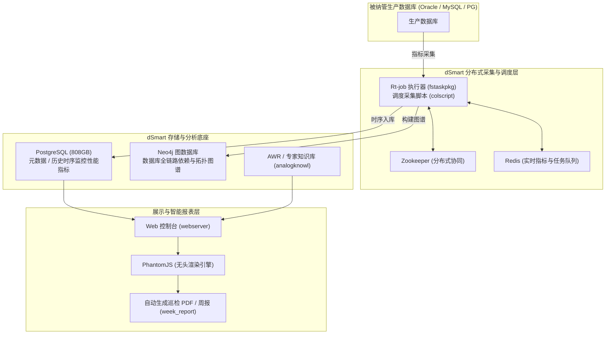
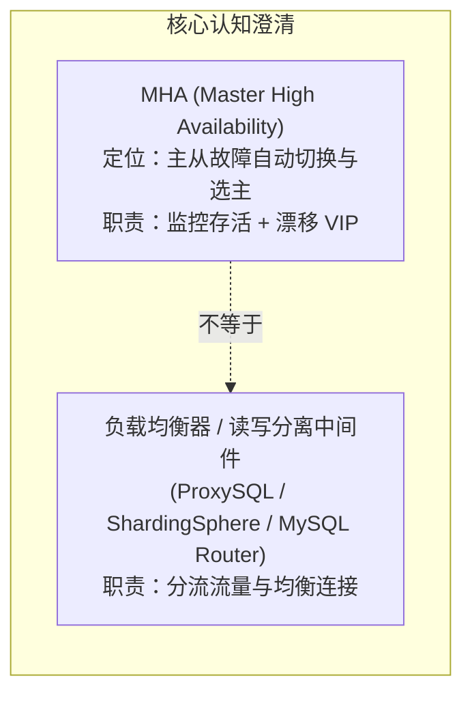

# 2026-09-21 日常工作处理总结 (数据库平台磁盘打满抢救、MHA延迟从库与架构流量治理)

---

> [!NOTE] 📋 日志元信息
> - **记录日期**：2026-09-21
> - **所属模块**：`02_Notes/` 日常工作处理总结
> - **涉及环境**：dSmart 智能运维平台服务器、MySQL MHA 高可用集群（`mdsn01` ~ `mdsn04`, `mha01`）、Windows 运维管理终端
> - **涉及核心组件**：PostgreSQL 10+ (`pgsql`)、XXL-Job / RT-Job 执行器、MySQL 5.7 MHA (Master/Slave)、延迟从库 (Delayed Replication)、Windows NCSI 路由

---

## 🎯 一、今日核心工作概览

今日工作主要围绕数据库底座与运维监控平台的**磁盘极危熔断抢救、架构机制剖析与生产高可用流量治理**展开，取得了多项重大突破与闭环：

1. **dSmart 运维平台磁盘 100% 打满（仅剩 21KB）与 PG 宕机紧急抢救**：
   - 深度定位 `pgsql/data/pg_log` 堆积 4 年日志（22G）与 `jobhandler` 每天 22G 调度日志暴涨两大根因；
   - 安全清理历史日志，释放 **150GB+** 磁盘空间，解决 `PANIC: No space left on device` 数据库崩溃死锁，恢复平台运转（使用率降至 87.1%）。
2. **dSmart (DBAIOPS) 智能运维系统架构与业务定位深度沉淀**：
   - 系统梳理了巡检周报（PhantomJS/PDF）、AWR 诊断引擎、Neo4j 依赖图谱与分布式采集底座的业务全貌。
3. **生产 MySQL 核心库（MHA 节点 `mdsn04`）2.0T 磁盘打满危急排障**：
   - 严守生产红线，严禁在 OS 层面暴力 `rm` binlog/relay log 导致 1236 复制中断；
   - 深度取证破译 `mdsn04` 是一台配置了 **`SQL_Delay = 86400`（24小时防误删延迟从库）**，定性 42G relay log 为正常回放缓冲并予以保护；
   - 通过 MySQL 原生 `PURGE BINARY LOGS` 缩减自身 binlog 至 3 天，释放 **35G~40GB** 空间，消除 99% 告警。
4. **Windows 客户端内网专网访问配置与双网卡避坑**：
   - 澄清纯内网环境下 NCSI 探测导致的“无网络访问权限”误报认知；
   - 确立双网卡（WiFi 外网 + 有线内网）“**内网网关留空 + `route add -p` 静态路由**”标准规范，杜绝路由冲突。
5. **MHA 架构高可用集群单机连接数异常（`mdsn01` 达 2966）深度剖析**：
   - 澄清核心误区：MHA 是故障切换组件而非负载均衡器，未做读写分离时 100% 流量通过 VIP 汇聚至单主；
   - 剖析上百个微服务 Pod 连接池（HikariCP）叠加累积机理，结合 `max_connections = 8000` 确立连接健康评估标准。

---

## 💥 二、dSmart 运维平台磁盘 100% 打满与 PG 宕机紧急抢救

### 1. 故障现象与危急态势
- 监控告警提示 dSmart 服务器挂载点 `/app`（总容量 1.1T）已被 **100% 耗尽，可用空间仅剩 21KB**。
- PostgreSQL 数据库进程彻底消失，查看最新日志发现启动时抛出致命崩溃：
  ```text
  PANIC:  could not create file "pg_logical/replorigin_checkpoint.tmp": No space left on device
  LOG:    startup process (PID 27890) was terminated by signal 6: Aborted
  LOG:    database system is shut down
  ```
  PostgreSQL 在尝试自动崩溃恢复时，因无法写入临时的 checkpoint 状态文件，直接触发系统 `PANIC` 保护性停机。

### 2. 深入只读取证：抓出两大空间巨头
在 `/app/software` 目录下执行只读空间分析：
```bash
du -sh * | sort -rh | head -n 5
# 输出：808G pgsql, 172G fstaskpkg
```

进一步逐层深挖：
1. **`808G pgsql` 内部构成**：
   - `pgsql/data/base`：**786G**（真实业务监控历史指标数据）；
   - `pgsql/data/pg_log`：**22G**（自 2022 年 10 月平台上线以来，长达 4 年的运行文本日志从未做过任何轮转与清理，积压了上千个 `.log` 文件）。
2. **`172G fstaskpkg` 内部构成**：
   - 定位到 Tomcat 应用目录 `tomcat-apache-fstask/webapps/Rt-job-executor/rt-job/jobhandler/`：
     ```text
     23G   .../jobhandler/2026-04-10
     22G   .../jobhandler/2026-04-11
     22G   .../jobhandler/2026-04-09
     22G   .../jobhandler/2026-04-08
     22G   .../jobhandler/2026-04-07
     22G   .../jobhandler/2026-04-06
     22G   .../jobhandler/2026-04-05
     17G   .../jobhandler/2026-04-12  (写到 17G 磁盘彻底仅剩 21k 崩盘)
     ```
   - **惊人规律**：RT-Job (XXL-Job) 调度器在执行数据库采集任务时，每个任务的控制台日志均未设置滚动上限，**每天以 22GB~23GB 的惊人速度吞噬磁盘，仅 8 天就霸占了 170GB！**

### 3. 风险评估与阶梯式安全处置

> [!CAUTION]
> **生产避坑红线**：
> 1. 严禁直接执行目录下的 `initdb.sh`（该脚本会调用 `initdb` 清空并重新格式化数据库，导致 786G 数据全部丢失）；
> 2. 严禁直接删改 `pgsql/data/base` 数据文件。

针对日志文件的删除进行了严密的业务影响评估：
* **清理 2022~2025 年 PG 日志**：对数据库数据完整性 **0 风险、0 影响**；
* **清理历史 Job 任务日志**：新调度会自动建目录，唯一影响是 Web 界面查看几天前已结束任务的日志时提示“文件不存在”，**对调度引擎与业务运行 0 风险**。

**执行命令与战果**：
```bash
# 1. 彻底删除 2022-2025 年积压的旧 pg_log（释放 20GB 空间）
rm -f pgsql/data/pg_log/postgresql-202[2-5]*.log

# 2. 清理 4月05日 至 4月10日 的历史任务调度纯文本日志（释放 130GB+ 空间）
rm -rf fstaskpkg/lib/tomcat-apache-fstask/webapps/Rt-job-executor/rt-job/jobhandler/2026-04-0[5-9]
rm -rf fstaskpkg/lib/tomcat-apache-fstask/webapps/Rt-job-executor/rt-job/jobhandler/2026-04-10
```
* **处置效果**：`/app` 磁盘可用空间瞬间从 **`21k` 飙升至 `150GB+`**，大盘显示分区使用率直接降至 **`87.1%`**，彻底解除系统由于空间耗尽导致的停摆死锁。

---

## 🏛️ 三、dSmart (DBAIOPS) 智能运维系统架构全景剖析

结合当前运行组件与交付脚本，系统性沉淀了 dSmart 平台的技术拓扑与数据链路：



* **定位**：专职服务于 DBA 与 SRE 的“数据库智能管家”，集监控采集、AWR 诊断、拓扑分析与周报自动生成于一体。
* **反思与防线**：作为监控平台的服务器，自身也必须建立定时日志轮转（Logrotate）与磁盘水位防范机制，避免“监控别人的工具自身先被日志撑爆”。

---

## 🛡️ 四、生产 MySQL 核心库（MHA 节点 `mdsn04`）2.0T 磁盘与延迟从库架构排查

### 1. 故障现象与空间分析
- 核心数据库节点 `mdsn04` 的 `/app` 挂载点（2.0T）只剩 **21GB（使用率 99.0%，爆红）**；
- 空间明细：`data/` 目录占 1.9T，`log/` 目录占 **108G**：
  - `66G   binlog`
  - `42G   relay`
  - `395M  error` / `348M  auditlog` / `91M  slow`

### 2. 深入只读取证与重大架构定性
进入 MySQL 执行 `SHOW SLAVE STATUS\G`，排查出极高价值的架构事实：

```text
Slave_IO_Running:        Yes
Slave_SQL_Running:       Yes
SQL_Delay:               86400  (整整 24 小时延迟！)
Slave_SQL_Running_State: Waiting until MASTER_DELAY seconds after master executed event
Seconds_Behind_Master:   86400
Relay_Master_Log_File:   bin-log.085501 (SQL 线程正在回放 24 小时前的事务)
Master_Log_File:         bin-log.085599 (IO 线程已拉取到主库最新事务)
```

#### 架构真相：
1. **`mdsn04` 是一台专门设立的「24小时防误删延迟从库 (Delayed Slave)」**：
   配置了 `MASTER_DELAY = 86400`。一旦生产主库发生恶性误操作（如执行 `DROP TABLE`、无 WHERE 的危险 `DELETE`），DBA 有整整 24 小时的黄金窗口直接在 `mdsn04` 上无损还原数据！
2. **42G 的 Relay log 是绝对不能手动删除的生命线**：
   因为 SQL 线程刻意落后 24 小时回放，本地必须暂存主库 24 小时内产生的所有 relay log 变更（共计 42GB）。**严禁在 OS 层面暴力 rm 删除**，否则将彻底破坏延迟回放链路！回放完成后 MySQL 会自动 purge。

### 3. 安全清理方案（突破口：清自身的 binlog）
* **真凶锁定**：`mdsn04` 自身开启了 `log_bin`，且 `expire_logs_days = 7`，自身积压了 **680 个 binlog 文件（66GB）**。
* **安全处置**：
  ```sql
  -- 1. 安全清理 3 天以前的 binlog（只删自身生成的 binlog，完全不影响从库延迟回放）
  PURGE BINARY LOGS BEFORE DATE_SUB(NOW(), INTERVAL 3 DAY);

  -- 2. 在线调优自动保留天数为 3 天（杜绝再次积压到 66G）
  SET GLOBAL expire_logs_days = 3;
  ```
* **效果**：瞬间释放 **35GB ~ 40GB+** 磁盘空间，可用空间扩大至 60GB 左右，大盘 99.0% 红色警报彻底解除。

---

## 🌐 五、Windows 客户端内网专网访问配置与双网卡避坑指南

针对 Windows 客户端配置内网访问时，状态显示 `IPv4 连接: 无网络访问权限` 进行了原理定性与规程标准化：

1. **“无网络访问权限”底层认知**：
   Windows 依赖 NCSI（Network Connectivity Status Indicator）向微软公网探测域名（`msftconnecttest.com`）发包。在**纯内网专网（无公网）环境**下，该提示属于 100% 正常现象，不代表内网通信故障。
2. **双网卡（WiFi 上外网 + 有线插网线上内网）生产避坑红线**：
   > [!WARNING]
   > **单机绝对不能配置两个默认网关！**
   > 若在有线内网网卡上配置了网关，会导致系统拥有两条 `0.0.0.0` 默认路由，产生选路冲突导致外网断网或内网走错网卡。
3. **双网卡标准化配置 SOP**：
   - **图形化配置**：内网网卡填入 IP（如 `10.2.10.166`）和子网掩码（`255.255.255.0`），**【默认网关】必须保持完全空白！**
   - **命令行路由注入**：以管理员身份打开 CMD，注入永久明细静态路由：
     ```cmd
     # 将 10.0.0.0/8 网段流量指定走内网真实网关 10.2.10.254
     route add -p 10.0.0.0 mask 255.0.0.0 10.2.10.254
     ```
   - 验证：在 CMD 执行 `ping 10.2.10.254` 与 `ping 目标内网服务器IP`，收到 ICMP 回显即代表内网完全通畅。

---

## ⚖️ 六、MHA 架构高可用集群单机连接数异常（`mdsn01` 达 2966）深度剖析

### 1. 现象与核心困惑
大盘监控显示：
* `mdsn01`：连接数高达 **2,966**（爆红，CPU 23.8%，内存 91%）；
* `mdsn02`：连接数 233；
* `mdsn03`：连接数 23；
* `mdsn04`：连接数 3。
* **用户困惑**：“部署了 MHA 之后，为什么连接数只有一台服务器异常高，而不是平均分配？”

### 2. 深度架构原理拆解



1. **MHA 根本不是负载均衡器**：
   MHA 仅承担故障检测与故障转移（Failover）。当主库发生故障宕机时，MHA 负责将从库提升为主库并完成 **VIP（虚拟 IP）漂移**。它在任何时候都**不参与应用层连接的分发与路由**！
2. **流量 100% 汇聚到单主的根因**：
   - 上游所有微服务的连接池配置的均是 **MHA 的 VIP 地址**；
   - 当前 `mdsn01` 是唯一的**活动主库（Active Master）**，VIP 正好绑定在 `mdsn01` 的物理网卡上；
   - 在未配置读写分离中间件的情况下，全网微服务的所有读（SELECT）与写（INSERT/UPDATE）**100% 全部进入 `mdsn01`**；
   - 从库（`mdsn02~04`）仅有复制线程、监控抓取或极少数离线报表直连，连接数自然极低。
3. **2966 个连接的数学构成**：
   - 查询确认 `max_connections = 8000`，当前 2966 处于安全范围（占比 37%）；
   - 该数值来源于**微服务连接池叠加**：
     $$\text{总连接数} = \text{微服务 Pod 数量 (约 100 个)} \times \text{每个 Pod 的连接池大小 (如 30)} \approx 3000$$
   - 通过 `SELECT command, COUNT(1) FROM information_schema.processlist GROUP BY command;` 可验证，若其中 95% 以上为 `Sleep`（空闲长连接保持），证明当前实例负载健康，无需盲目 kill。

---

## 💡 七、今日核心沉淀与避坑备忘

1. **“资产未清严禁写操作”红线的生命线价值**：
   在 `mdsn04` 磁盘告警中，若在未执行 `SHOW SLAVE STATUS` 取证前就盲目删除 42G 的 relay log，将直接造成 24 小时延迟防误删体系的崩溃中断。全只读取证先行是 SRE 保命的核心铁律。
2. **任务调度系统的自我清理规范**：
   调度器（如 XXL-Job、RT-Job、Elastic-Job）作为高频触发组件，必须强制在应用层配置 `jobhandler` 本地日志保留周期（通常设为 3~7 天），禁止将标准输出无限写入容器或宿主机目录。
3. **高可用集群架构的边界认知**：
   MHA 解决的是“可用性与自动容灾（HA）”问题，解决不了“读写扩展与负载均衡（Scalability）”问题；当单主库连接数与 CPU 持续承压时，下一步演进方向必须是引入 **ProxySQL / 读写分离中间件**。

---

> [!TIP] 💡 关联技术与延伸阅读
> 
> * 查阅前一天全栈攻坚总结：[`./2026-09-20.md`](./2026-09-20.md)
> * 查阅企业级 MHA 部署工程脚本：[`../05-Install/mysql/mysql-MHA-5.7/dsmart_community_deploy.sh`](../05-Install/mysql/mysql-MHA-5.7/dsmart_community_deploy.sh)
> * 查阅全局云原生与基础架构规则：[`../GEMINI.md`](../GEMINI.md)
> * 查阅智能体避坑与长期记忆备忘：[`../LEARNING.md`](../LEARNING.md)
