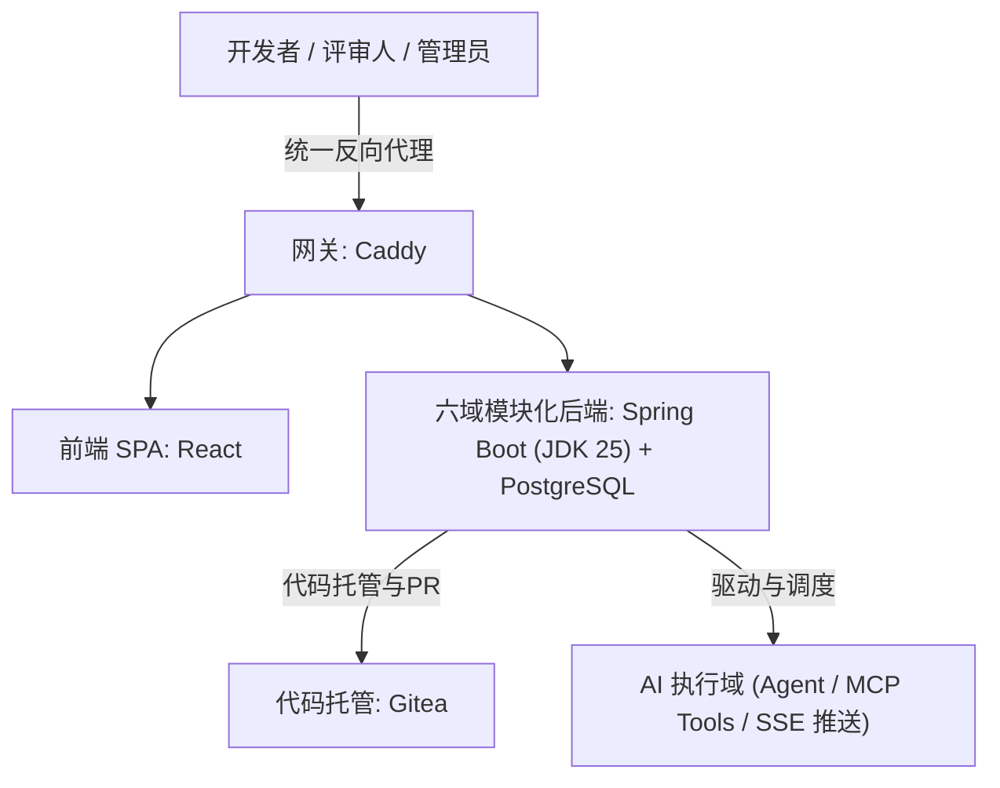
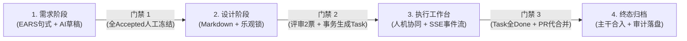

# 【课题立项】基于本体管理的智能 DevOps 平台 (wpd-platform) 架构与人机协同门禁体系

---

> [!NOTE]
> **原始参考来源**：
> * 文章标题：[分享一个基于本体管理的智能DevOps平台(wpd-platform)设计方案](https://mp.weixin.qq.com/s/XXVmaHkJIGY6taW1kTVKRg)
> * 来源公众号：月夜烛峰（发布时间：2026-09-28）
> * 本文定位：AI Agent 企业级落地治理、规范化门禁设计与可审计智能运维平台攻坚研究立项。

---

## 1. 调研背景与核心痛点 (Why)

随着大语言模型（LLM）与 Coding Agent（如 Claude Code、Cursor、Antigravity）能力的爆发，研发与运维团队逐步尝试将 AI 引入实际生产。然而在企业级实际落地过程中，单纯依赖大模型生成代码或执行命令面临**无法跨越的信任与工程化鸿沟**：

1. **幻觉与失控风险**：缺乏硬性门禁，Agent 自主修改代码或执行脚本时容易失控引入严重 Bug；
2. **设计与任务脱节**：传统开发中需求、设计与执行任务由不同人手动维护，容易导致“设计写一套、代码写一套”的割裂；
3. **缺乏准入门槛**：Agent 任意被配置和派活，缺乏安全基准与技能测评，质量不可靠；
4. **审计与合规黑盒**：AI 调用的工具、修改的代码、产生的 Token 消耗缺乏防篡改台账，且平台用量与服务商账单经常对不上账，缺乏财务对账机制。

**核心启发**：该设计方案的核心价值**不在于底层模型有多强**，而在于**将 AI 嵌入到一个有门禁、有审计、有对账、人机协同的完整工程化治理流程中**。模型会不断演进淘汰，但沉淀下来的软件工程规范流程与合规框架才是不可替代的核心资产。

---

## 2. 平台核心架构与技术选型

该平台技术选型务实，以主流工业级栈为主，核心拓扑如下：

* **前端**：React SPA 交互应用；
* **后端**：Spring Boot（基于现代化 JDK 25）+ PostgreSQL；
* **网关与基建**：Caddy（极简配置与自动证书）+ Gitea（自建 Git 代码平台）+ Docker Compose 容器编排。

---

## 3. 核心机制解密与治理设计 (Core Architectural Pillars)

### 3.1 规格驱动开发 (SDD) 与“四阶段三门禁”工作流

平台以 **SDD（Spec-Driven Development，规格驱动开发）** 为核心骨架，全流程贯穿**四阶段三门禁**，由人工进行严格决策把关：

#### 门禁流转核心要点：
1. **需求阶段（EARS 句式约束）**：
   * 采用国际标准的 **EARS（Easy Approach to Requirements Syntax）** 规则描述需求（如 `WHEN ... THEN THE SYSTEM SHALL ...`），消除自然语言歧义；
   * AI 自动生成 6~8 条带「AI 草稿」标记的初始需求条目，必须由人工逐条确认接受（Accepted）；
2. **门禁 1（需求冻结与版本锁定）**：
   * 需求全部 Accepted 后通过**门禁 1**，生成 `specVersion` 不可变快照并记录批准人；
   * 设计文档提供结构化 Markdown 编辑区，防编辑冲突引入乐观锁，设计驳回必须强制填写原因；
3. **门禁 2（设计即代码源，事务自动派生任务）**：
   * 评审投票需满足 2 票（同一评审人单版本限投一票）；
   * 达成 2 票的瞬间，在**同一数据库事务**内完成两件事：**通过门禁 2**，并**直接按设计文档的二级标题自动生成对应任务列表**（平台不提供手动增删任务按钮），彻底保障“设计文档与开发任务的单一事实源”；
4. **执行工作台（白盒人机协同）**：
   * **三栏工作区**：左栏规格与设计上下文、中栏对话与决策流、右栏执行概览（Agent 信息、绑定工具、产出物 Diff）；
   * **SSE 实时事件流**：实时推送 17 类细粒度事件（LLM 轮次、工具调用、diff、PR 等）；
   * **单次工具调用确认**：可随时关闭自主模式，每个工具调用（如写入文件、执行命令）执行前自动停靠等待人工审批（支持“批准/拒绝/暂停/恢复/停止/转人工”）；
5. **门禁 3（代操作合并与终态归档）**：
   * 所有任务状态置为 Done 且关联 Gitea PR 后激活门禁 3；
   * 平台以代操作者身份调用 Gitea API 自动合并所有 PR，规格状态转为 `merged`，写入 `SPEC_MERGED` 审计节点，天然幂等防二次合并。

---

### 3.2 Agent 中心：严密准入门槛的“数字员工”

Agent 不能作为黑盒直接调用，必须建立准入机制：

* **注册四步向导**：基本信息 $\rightarrow$ 能力定义（Prompt 与选定模型） $\rightarrow$ 资产绑定（MCP 工具、代码库引用） $\rightarrow$ 试运行与发布；
* **发布硬性门禁**：内置评测集必须达到 **6/6 测试用例全绿通过** 方可上架发布；草稿态或已下线的 Agent 坚决不出现在任务指派下拉列表中；
* **版本克隆与防篡改**：修改能力必须克隆生成版本草稿，历史版本执行记录永远可追溯。

---

### 3.3 审计台账与真实成本对账机制

* **哈希链防篡改审计台账**：
  平台所有敏感操作记录（时间、操作人、动作、受影响对象）均以前向哈希指针连接成**哈希链（Hash Chain）**，提供一键整链验真能力，任何篡改均会导致整链失效；
* **真实成本分歧对账工单**：
  * 平台内部记录高精度（六位精度分档）Token 与工具耗时开销；
  * 定期与大模型供应商（OpenAI、Anthropic、智谱等）实际账单对比；
  * 一旦存在分歧差额，自动开具**分歧对账工单**，走 `触发对账 -> 开单认领 -> 裁决打回` 标准财务治理流。

---

## 4. 核心研究问题清单 (Questions to Answer)

1. **本体管理与单一事实源（Single Source of Truth）**：
   * 如何利用数据库事务机制与 AST，将结构化设计文档与下层任务、PR、代码 Diff 形成强关联图谱？
2. **人机协作断点与控制反转（HITL - Human-in-the-Loop）**：
   * 在 Agentic Loop 中，如何设计基于 SSE / WebSocket 的“断点停靠”与人工授权机制，使 AI 在执行写操作、运行命令前受到严格约束？
3. **Agent 质量评测基准工程化（Eval Harness）**：
   * 如何针对具体企业业务快速搭建 6/6 或自动化 Eval 评测套件，防止 Agent 提示词变更引起能力劣化？
4. **与云原生基础设施协同**：
   * 该平台与 K8s 集群发布、ArgoCD GitOps、MySQL 数据库运维 Agent 如何通过标准化 MCP 协议无缝对接？

---

## 5. 攻坚路线与阶段规划 (Action Plan)

- [ ] **Stage 1 - 理念消化与 EARS 句式规范化**：
  * 在知识库模板中引入 EARS 需求标准表达，测试让 AI 按 `WHEN...THEN THE SYSTEM SHALL` 拆解研发与运维需求。
- [ ] **Stage 2 - 人机协同安全机制与断点设计**：
  * 深入分析 Antigravity、Claude Code 等现有工具的 PreToolUse 拦截与确认机制，设计一套在终端与 Web 端通用的人机确认接口。
- [ ] **Stage 3 - 审计与对账模型抽象**：
  * 设计轻量级的防篡改哈希链（Hash Chain）数据结构示例，梳理 LLM Token 成本统计与开销计量模型。
- [ ] **Stage 4 - 成果沉淀**：
  * 提炼企业级 AI 原生研发运维平台设计标准，归档至 `01_Inbox/`。

---

## 6. 溯源与参考资料 (References)

* **原始公众号链接**：[分享一个基于本体管理的智能DevOps平台(wpd-platform)设计方案](https://mp.weixin.qq.com/s/XXVmaHkJIGY6taW1kTVKRg)
* **发布者**：微信公众号【月夜烛峰】
* **相关前置技术**：
  * 规格驱动开发：Spec-Driven Development (SDD) & EARS 语法
  * 协议规范：Model Context Protocol (MCP) & Server-Sent Events (SSE)

---

> [!TIP] 💡 关联技术与延伸阅读
>
> * [AI 在现代 IDE 中的运行机制与本地动态加载体系深度剖析](./01-AI在IDE中的运行机制与本地动态加载体系.md)
> * [待研究选题与攻坚灵感看板](./BACKLOG.md)
> * [AI Coding Agent 上下文工程与沙箱隔离技术](../../01_Inbox/README.md)
